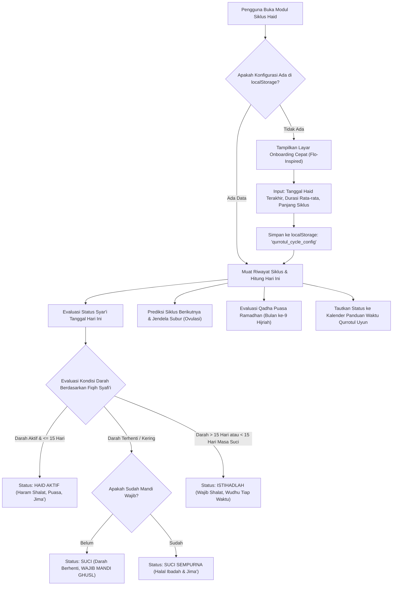

# TASK-002: Fitur Pencatatan Siklus Haid & Masa Subur Islami Terpadu (Flo-Inspired with Islamic Fiqh Integration) - Product Requirement Document (PRD)

> **Feature:** Fitur Pencatatan Siklus Haid & Masa Subur Islami Terpadu  
> **Author:** Faisal (Product Manager & Business Analyst)  
> **Date:** 2026-10-20  
> **Status:** DRAFT & FROZEN FOR ALIGNMENT  
> **Target Release:** Qurrotul Uyun Web & PWA v1.3.0  
> **Target Path:** `src/app/siklus-haid/` & `src/lib/cycle-engine/`

---

## 1. Executive Summary & Problem Statement

### 1.1 Problem Statement
Aplikasi pelacak menstruasi populer (seperti Flo, Clue, Period Tracker) dirancang murni berbasis kalkulasi biologis sekuler tanpa mengakomodasi hukum syariat Islam. Bagi wanita muslimah, pendarahan bukan sekadar urusan biologis, melainkan parameter krusial penentu keabsahan ibadah harian (shalat, puasa, tilawah Al-Qur'an, thawaf) dan hukum hubungan intim suami-istri (jima').

Tantangan utama yang dihadapi pengguna muslimah:
1. **Ketidakpastian Hukum Darah:** Seringkali muslimah bingung membedakan antara darah Haid dan darah Istihadlah (darah penyakit) menurut kaidah fiqih, terutama ketika pendarahan melebihi 15 hari atau keluar sebelum jeda suci 15 hari.
2. **Ketiadaan Pengingat Mandi Wajib (Ghusl):** Aplikasi konvensional tidak menyediakan panduan verifikasi berakhirnya darah (tanda *Qashshah Baidha'* atau *Jufuf*) dan kewajiban mandi junub sebelum dapat kembali beribadah dan berjima'.
3. **Kewajiban Qadha Puasa yang Terlupakan:** Haid di bulan Ramadhan mewajibkan qadha puasa, namun belum ada pelacak otomatis yang menghitung hutang puasa Ramadhan dan memantau pelunasannya sebelum Ramadhan berikutnya.
4. **Kekhawatiran Privasi Data Reproduksi:** Aplikasi komersial luar negeri kerap memonetisasi atau menjual data siklus reproduksi ke pihak ketiga. Pengguna membutuhkan privasi mutlak tanpa kebocoran data (*zero server leakage*).

### 1.2 Objective
Membangun modul pencatatan siklus haid, masa subur, dan prediksi ovulasi yang memadukan kenyamanan antarmuka modern terinspirasi dari aplikasi Flo dengan ketepatan hukum Fiqih Wanita standar Mazhab Syafi'i dan tuntunan Kitab Qurrotul Uyun.

Seluruh data tersimpan 100% di penyimpanan lokal peramban (*client-side localStorage*), bebas dari pelacak pihak ketiga, terintegrasi mulus dengan Kalender Panduan Waktu Qurrotul Uyun, serta dilengkapi pelacak qadha puasa Ramadhan.

### 1.3 Target Audience & User Persona
1. **Persona 1: Muslimah Aktif & Istri Beribadah (Siti, 28 tahun)**
   - Kebutuhan: Mengetahui kepastian status ibadah harian (apakah wajib shalat/puasa atau terlarang), mendapatkan panduan thaharah yang runtut, dan mencatat hutang puasa Ramadhan tanpa takut lupa.
2. **Persona 2: Pasangan Program Hamil / Ikhtiar Konsepsi (Rahmat & Aisyah, 26 tahun)**
   - Kebutuhan: Mengetahui jendela masa subur (*fertile window*) dan hari ovulasi puncak untuk ikhtiar kehamilan, diselaraskan dengan waktu-waktu yang dianjurkan dalam Kitab Qurrotul Uyun.
3. **Persona 3: Muslimah dengan Riwayat Siklus Tidak Teratur (Fatimah, 24 tahun)**
   - Kebutuhan: Memerlukan bimbingan algoritmik fiqih saat darah keluar berhari-hari untuk membedakan batas maksimal haid 15 hari dan tata cara shalat bagi wanita mustahadhah (*da'imul hadats*).

### 1.4 Success Metrics
- **Akurasi Fiqih 100%:** Algoritma deterministik mematuhi batasan Mazhab Syafi'i (minimal haid 24 jam, maksimal 15 hari, minimal suci 15 hari) tanpa inkonsistensi status hukum.
- **Privasi & Keamanan:** 0 KB data kesehatan reproduksi yang dikirim ke jaringan luar (zero telemetry / zero server leakage).
- **Performa Ringan:** Bundle size modul < 25 KB gzipped, LCP < 1.2s, INP < 100ms, zero external heavy charting libraries.
- **Kemudahan Adopsi:** Alur pencatatan harian selesai dalam kurang dari 15 detik (maksimal 3 ketukan layar).

---

## 2. User Personas & Target Audience

| Persona | Profil & Kebutuhan Utama | Hambatan Saat Ini | Solusi dalam Fitur |
|---|---|---|---|
| **Siti (Istri & Ibu Muda)** | Ingin kepastian shalat harian dan mencatat qadha puasa Ramadhan | Aplikasi barat tidak tahu kapan harus mandi wajib dan tidak menghitung qadha puasa | Indikator status syar'i harian, panduan verifikasi suci (*Qashshah Baidha'* / *Jufuf*), dan Qadha Puasa Counter otomatis |
| **Aisyah (Pejuang Garis Dua)** | Merencanakan konsepsi alami dan mencari waktu afdhal jima' | Aplikasi sekuler tidak mengaitkan masa subur dengan adab islami dan doa jima' | Visualisasi ovulasi terpadu dengan rekomendasi hari utama Kitab Qurrotul Uyun dan doa perlindungan |
| **Fatimah (Siklus Khusus)** | Mengalami pendarahan berkepanjangan (> 15 hari) | Kebingungan apakah darah tersebut haid atau istihadlah dan apakah tetap berdosa bila shalat | Evaluasi algoritma istihadlah otomatis sesuai Mazhab Syafi'i disertai panduan praktis wudhu tiap waktu shalat |

---

## 3. User Stories (US-01 through US-08)

### US-01: Onboarding Siklus & Prediksi Berkala
Sebagai seorang muslimah, saya ingin mengisi konfigurasi dasar siklus haid saya (tanggal mulai haid terakhir, rata-rata durasi haid, dan panjang siklus rata-rata) agar sistem dapat menghitung perkiraan hari haid berikutnya dan kalender siklus saya secara otomatis.

### US-02: Status Syar'i Harian Fiqih Syafi'i
Sebagai seorang muslimah yang menjalankan ibadah shalat dan puasa, saya ingin melihat badge status syar'i harian yang jelas (Haid, Suci/Thaharah, atau Istihadlah) pada hari ini dan setiap tanggal yang dipilih, lengkap dengan keterangan hukum ibadah (larangan atau kewajiban shalat dan puasa).

### US-03: Pencatatan Gejala Harian (Flo-Style Daily Log)
Sebagai pengguna, saya ingin mencatat intensitas aliran darah harian (Bercak/Spotting, Ringan, Sedang, Deras), gejala fisik (kram, kembung, pusing, nyeri payudara, kelelahan, jerawat), suasana hati (bahagia, tenang, cemas, sensitif, sedih), dan karakteristik cairan vagina (kering, lengket, creamy, egg-white/subur) agar riwayat kesehatan reproduksi saya terdokumentasi rapi.

### US-04: Penanda Masa Subur & Ovulasi Islami
Sebagai pasangan yang berikhtiar kehamilan, saya ingin melihat visualisasi jendela masa subur (*fertile window*) dan tanggal ovulasi puncak pada kalender, yang diselaraskan dengan adab dan doa hubungan intim suami-istri dari Kitab Qurrotul Uyun.

### US-05: Deteksi Cerdas & Bimbingan Darah Istihadlah
Sebagai muslimah yang mengalami pendarahan tidak beraturan (darah keluar kurang dari 24 jam akumulatif, atau melebihi 15 hari 15 malam, atau muncul sebelum 15 hari masa suci), saya ingin sistem secara otomatis mengidentifikasi status Istihadlah dan memberikan edukasi tata laksana bersuci dan kewajiban shalat fardhu.

### US-06: Pelacak Qadha Puasa Ramadhan Otomatis
Sebagai muslimah yang berhutang puasa Ramadhan akibat datang bulan, saya ingin sistem mendeteksi hari haid yang bertepatan dengan bulan Ramadhan Hijriah secara otomatis, menghitung akumulasi hutang puasa, dan menyediakan daftar centang (*checklist*) pelunasan qadha puasa.

### US-07: Sinergi dengan Kalender Panduan Waktu Qurrotul Uyun
Sebagai pasangan suami-istri, saya ingin kalender waktu Qurrotul Uyun otomatis menandai larangan senggama selama masa haid, serta memberikan rekomendasi waktu utama (seperti Malam Jumat atau Hari Senin) seketika setelah istri bersuci dan mandi wajib.

### US-08: Kedaulatan Privasi Lokal, Ekspor, dan Impor Data
Sebagai pengguna yang menjunjung tinggi privasi data intim, saya ingin semua data tersimpan secara lokal di browser saya (*localStorage*), tanpa analitik pelacak luar, dengan fitur pencadangan (*export*) dan pemulihan (*import*) berkas JSON mandiri.

---

## 4. Fiqih Rules Matrix (Mazhab Syafi'i Standard)

Tabel berikut menjadi acuan logika deterministik mesin kalkulasi siklus (`cycle-engine.ts`):

| Parameter Syariat | Haid (Menstruasi) | Suci (Thaharah) | Istihadlah (Darah Penyakit) |
|---|---|---|---|
| **Definisi Fiqih** | Darah yang keluar dari pangkal rahim wanita sehat pada waktu tertentu | Kondisi terbebas dari darah haid dan nifas | Darah penyakit yang keluar di luar waktu haid dan nifas |
| **Batas Minimal Durasi** | 1 hari 1 malam (24 jam akumulatif dalam 15 hari) | 15 hari 15 malam (jeda minimal antar 2 haid) | Tidak ada batas minimal (bisa < 24 jam) |
| **Batas Umum (Ghalib)** | 6 atau 7 hari | 23 atau 24 hari | Beragam tergantung kondisi fisik/medis |
| **Batas Maksimal Durasi** | 15 hari 15 malam (360 jam) | Tidak ada batas maksimal (bisa berbulan-bulan) | Melebihi 15 hari atau keluar di masa suci |
| **Hukum Shalat Fardhu** | **Haram.** Gugur kewajiban shalat, dilarang shalat dan tidak di-qadha | **Wajib.** Menjalankan shalat fardhu dan sunnah sebagaimana biasa | **Wajib.** Shalat tetap sah dan wajib dikerjakan dengan tata cara wudhu khusus |
| **Hukum Puasa** | **Haram.** Dilarang berpuasa; wajib meng-qadha puasa Ramadhan yang ditinggalkan | **Wajib/Sunnah.** Sah berpuasa fardhu maupun sunnah | **Wajib/Sunnah.** Sah berpuasa fardhu maupun sunnah; darah keluar tidak membatalkan puasa |
| **Hukum Membaca/Sentuh Mushaf** | **Haram.** Dilarang menyentuh, membawa mushaf Al-Qur'an, dan melafalkan ayat dengan niat qira'ah | **Halal/Boleh.** Dianjurkan tilawah dan tadabbur | **Halal/Boleh.** Sama seperti wanita suci setelah berwudhu |
| **Hukum Hubungan Intim (Jima')** | **Haram Qath'i.** Berdosa besar; sunnah membayar kaffarah sedekah 1 dinar / 1/2 dinar | **Halal.** Setelah mandi wajib (ghusl) selesai dilaksanakan secara sempurna | **Mubah/Boleh.** Diperbolehkan menurut pendapat mu'tamad bila ada hajat suami-istri |
| **Tanda Selesai / Berakhir** | 1. *Qashshah Baidha'* (cairan putih bening) atau 2. *Jufuf* (kering kapas putih bersih) | Ditandai dengan keluarnya darah haid baru setelah minimal 15 hari suci | Darah berhenti mengalir kembali atau kembali ke siklus kebiasaan (*adat*) |
| **Kewajiban Mandi Wajib (Ghusl)** | **Wajib Ghusl** seketika darah terputus sebelum boleh shalat dan jima' | Tidak ada mandi wajib kecuali berhadats besar karena jima' atau mimpi basah | **Tidak Wajib Ghusl** untuk tiap shalat; cukup membersihkan darah dan berwudhu |
| **Prosedur Thaharah Khusus** | Niat mandi wajib haid, membasuh seluruh tubuh dari ujung rambut hingga kaki | Wudhu biasa untuk hadats kecil | Bersihkan kemaluan, pasang pembalut rapat, wudhu setelah masuk waktu shalat fardhu (1 wudhu = 1 shalat fardhu) |

---

## 5. Functional Specifications & Flow

### 5.1 Siklus Hidup & Arsitektur Modul (`cycle-engine`)



### 5.2 Komponen Antarmuka Pengguna (UI Wireframe Hierarchy)

Modul `/siklus-haid` terdiri dari 5 blok komponen utama:

1. **Cycle Hero Status Card (`CycleHeroCard.tsx`)**
   - Lingkaran cincin siklus interaktif (menampilkan "Hari ke-X Siklus", perkiraan hari haid berikutnya, atau fase subur).
   - Badge Status Syar'i Besar dengan token warna syar'i:
     - Merah Rose (`bg-rose-500/15 text-rose-700 dark:text-rose-300`): **Haid Aktif**
     - Kuning Amber (`bg-amber-500/15 text-amber-700 dark:text-amber-300`): **Istihadlah**
     - Biru Sky (`bg-sky-500/15 text-sky-700 dark:text-sky-300`): **Suci (Belum Mandi Wajib)**
     - Hijau Zamrud (`bg-emerald-500/15 text-emerald-700 dark:text-emerald-300`): **Suci Sempurna (Halal)**
   - Tombol Aksi Cepat: "Catat Aliran Darah Hari Ini" dan "Konfirmasi Mandi Wajib".

2. **Daily Symptom & Mood Logger Modal (`DailyLogModal.tsx`)**
   - Modal geser (*bottom sheet* di mobile, modal dialog di desktop) bergaya Flo:
     - **Tingkat Aliran Darah:** Bercak (Spotting), Ringan (Light), Sedang (Medium), Deras (Heavy), Tidak Ada (Kering/Jufuf).
     - **Verifikasi Tuntas Haid:** Toggle *Qashshah Baidha'* (cairan putih) atau *Jufuf* (kapas bersih).
     - **Gejala Fisik (Pill Multi-Select):** Kram Perut, Nyeri Payudara, Kembung, Sakit Kepala, Kelelahan, Jerawat, Nyeri Punggung Bawah.
     - **Suasana Hati / Mood (Emoji Pills):** 😊 Bahagia, 😌 Tenang, 😰 Cemas, 🥺 Sensitif, 😢 Sedih, 😡 Mudah Marah.
     - **Cairan Vagina / Keputihan:** Kering, Lengket, Creamy, Egg-White (Licin/Subur), Keruh.
     - **Aktivitas Hubungan (Jima'):** Dilakukan (dengan proteksi/doa), Tidak Dilakukan.

3. **Interactive Cycle Calendar Strip & Grid (`CycleCalendarView.tsx`)**
   - Strip tanggal horizontal 14 hari terdekat dan toggle tampilan kalender bulanan penuh.
   - Titik/lingkaran penanda fase:
     - Titik Merah: Periode Haid tercatat / terprediksi.
     - Titik Teal/Cyan: Jendela Masa Subur (*Fertile Window*).
     - Bintang Ungu: Perkiraan Hari Ovulasi Puncak (*Peak Conception Day*).
     - Titik Kuning: Periode Istihadlah.
     - Tanda Air/Embun: Waktu Mandi Wajib terverifikasi.

4. **Ramadan Qadha Puasa Tracker Card (`QadhaTrackerCard.tsx`)**
   - Ringkasan otomatis: "Hutang Puasa Ramadhan Tahun Ini: X Hari".
   - Daftar periksa interaktif (Checklist 1 s/d X) dengan tombol pelunasan: "Tandai 1 Hari Qadha Selesai".
   - Kutipan dalil Fiqih: Hadits Aisyah radhiyallahu 'anha mengenai kewajiban qadha puasa dan tidak adanya qadha shalat bagi wanita haid (HR. Muslim).

5. **Fiqih Guide Accordion & Data Controls (`FiqihGuideDrawer.tsx` & `CycleDataBackup.tsx`)**
   - Panduan ringkas tata cara bersuci, niat mandi wajib haid (Arab, Latin, Terjemahan), adab jima' ba'da suci menurut Kitab Qurrotul Uyun.
   - Kontrol Kedaulatan Data: Tombol "Ekspor Data Siklus (JSON)", "Impor Cadangan", dan "Hapus Seluruh Data Pribadi".

---

## 6. Scope & Ponytail Boundaries (No Slop, YAGNI)

### 6.1 In Scope
- **Kalkulasi Siklus Deterministik:** Siklus rata-rata (default 28 hari, configurable 21-45 hari), durasi haid rata-rata (default 6-7 hari, max fiqih 15 hari), fase luteal 14 hari.
- **Prediksi Ovulasi & Masa Subur:** Jendela subur (hari ovulasi minus 5 hari hingga hari ovulasi plus 1 hari).
- **Klasifikasi Status Syar'i Mazhab Syafi'i:** Deteksi otomatis Haid (< 15 hari), Suci (termasuk verifikasi mandi wajib), dan Istihadlah (> 15 hari pendarahan atau pendarahan sebelum jeda suci 15 hari).
- **Daily Logging Praktis (Flo Style):** Aliran darah, gejala fisik, suasana hati, cairan vagina, dan catatan jima'.
- **Integrasi Kalender Qurrotul Uyun:** Sinkronisasi dua arah via event dispatcher / shared local storage state ke `/panduan-waktu`.
- **Qadha Puasa Ramadhan Counter:** Penghitungan otomatis hari haid pada bulan ke-9 Hijriah dan pelacakan pelunasan.
- **Penyimpanan Lokal Murni:** Menggunakan `localStorage` dengan skema data versi 1 (`qurrotul_cycle_v1`), fungsi ekspor/impor berkas JSON mandiri.

### 6.2 Out of Scope (Ponytail / YAGNI Strict Filter)
- **TIDAK ADA Backend API / Cloud Database:** Tidak membuat database PostgreSQL, Prisma, Supabase, atau Firebase. Semua data 100% lokal di perangkat pengguna.
- **TIDAK ADA Akun Pengguna / Login Medsos:** Tidak ada pendaftaran email, Google Auth, atau nomor telepon. Privasi kesehatan intim mutlak terjaga.
- **TIDAK ADA Pelacak Suhu Basal Tubuh (BBT) Bluetooth Hardware:** Tidak menghubungkan perangkat keras thermometer eksternal.
- **TIDAK ADA Artificial Intelligence / LLM Medis Diagnostik:** Aplikasi tidak memberikan resep obat hormon atau klaim medis kedokteran; fokus eksklusif pada klasifikasi fiqih dan ritme siklus.
- **TIDAK ADA Notifikasi Push Server / SMS:** PWA local notification via Service Worker Serwist diperkenankan secara opsional di kemudian hari, namun push server pihak ketiga ditolak.
- **TIDAK ADA Grafik Charting Berat (Chart.js / D3.js):** Visualisasi siklus dibuat dengan CSS murni dan SVG ringkas (< 5 KB), tanpa menambah library grafik eksternal.

---

## 7. Detailed Acceptance Criteria (Gherkin AC-01 to AC-08)

### AC-01: Onboarding Siklus & Prediksi Siklus Berkala
```gherkin
Scenario: Pengguna baru mengatur profil siklus untuk pertama kali
  Given pengguna membuka halaman "/siklus-haid" dan belum memiliki data tersimpan
  When dialog onboarding pertama muncul
  And pengguna memasukkan tanggal haid terakhir "2026-10-01", durasi haid "7" hari, dan panjang siklus "28" hari
  And menekan tombol "Mulai Pencatatan"
  Then sistem menyimpan konfigurasi ke "localStorage" dengan key "qurrotul_cycle_v1"
  And sistem memprediksi hari haid berikutnya jatuh pada "2026-10-29"
  And sistem menampilkan cincin siklus dengan status hari berjalan secara akurat
```

### AC-02: Status Syar'i Dinamis Berdasarkan Mazhab Syafi'i
```gherkin
Scenario Outline: Sistem menentukan status syar'i harian berdasarkan durasi darah dan jeda suci
  Given pengguna memiliki catatan aliran darah pada rentang tanggal tertentu
  When sistem mengevaluasi tanggal dengan kondisi <kondisi_pendarahan>
  Then badge status syar'i harian menampilkan <status_syari>
  And sistem menampilkan panduan ibadah <panduan_ibadah>
  And status hubungan jima' dinyatakan <status_jima>

  Examples:
    | kondisi_pendarahan | status_syari | panduan_ibadah | status_jima |
    | "Darah mengalir hari ke-1 sampai hari ke-7" | "Haid Aktif" | "Haram shalat dan puasa; tidak wajib qadha shalat" | "Haram Mutlak" |
    | "Darah berhenti hari ke-7, belum mandi wajib" | "Suci (Wajib Ghusl)" | "Wajib segera mandi wajib agar dapat shalat" | "Belum Halal sebelum Mandi" |
    | "Darah berhenti hari ke-7, sudah konfirmasi mandi" | "Suci Sempurna" | "Wajib shalat fardhu dan sah berpuasa" | "Halal Sesuai Adab" |
    | "Darah terus mengalir hingga hari ke-16" | "Istihadlah" | "Wajib shalat dan puasa; bersihkan darah dan wudhu tiap waktu shalat" | "Mubah Jika Ada Hajat" |
    | "Darah baru keluar pada hari ke-8 setelah suci haid lalu" | "Istihadlah (Belum 15 Hari Suci)" | "Wajib tetap shalat dan puasa; belum genap masa suci minimal 15 hari" | "Mubah Jika Ada Hajat" |
```

### AC-03: Logging Harian Komprehensif (Flo-Style Daily Log)
```gherkin
Scenario: Pengguna mencatat gejala harian, aliran darah, dan suasana hati
  Given pengguna membuka modal pencatatan pada tanggal terpilih
  When pengguna memilih intensitas aliran "Sedang"
  And memilih gejala "Kram Perut" dan "Sakit Kepala"
  And memilih suasana hati "Sensitif"
  And memilih jenis cairan vagina "Lengket"
  And menekan tombol "Simpan Catatan Harian"
  Then data tersimpan ke dalam array "dailyLogs" pada objek tanggal tersebut
  And tanggal pada strip kalender menampilkan titik indikator aliran darah
  And ringkasan catatan harian langsung tertera pada detail tanggal tanpa memuat ulang halaman
```

### AC-04: Kalkulasi & Visualisasi Masa Subur (Fertility & Ovulation Window)
```gherkin
Scenario: Sistem menghitung jendela subur dan hari ovulasi untuk ikhtiar konsepsi
  Given pengguna memiliki panjang siklus rata-rata 28 hari dan tanggal mulai haid "2026-10-01"
  When sistem memproses algoritma prediksi ovulasi (fase luteal 14 hari)
  Then tanggal ovulasi puncak dihitung jatuh pada "2026-10-14"
  And jendela masa subur (fertile window) ditandai dari tanggal "2026-10-09" hingga "2026-10-15"
  And sel tanggal ovulasi menampilkan ikon bintang subur dengan rujukan adab jima' Kitab Qurrotul Uyun
```

### AC-05: Algoritma & Notifikasi Penanganan Istihadlah
```gherkin
Scenario: Sistem mendeteksi pendarahan abnormal melampaui batas maksimal haid 15 hari
  Given seorang muslimah mencatat darah terus keluar berturut-turut hingga hari ke-16
  When sistem menjalankan validasi kaidah Fiqih Syafi'i
  Then sistem secara otomatis mengubah status tanggal ke-16 dari "Haid" menjadi "Istihadlah"
  And kartu peringatan khusus menampilkan instruksi:
    "Pendarahan telah melebihi batas maksimal haid (15 hari 15 malam). Anda berstatus mustahadhah: wajib mandi satu kali untuk membersihkan hadats haid sebelumnya, kemudian wajib menunaikan shalat fardhu dan puasa dengan memperbarui wudhu pada setiap masuk waktu shalat."
  And tombol panduan tata cara wudhu da'imul hadats dapat diakses langsung oleh pengguna
```

### AC-06: Pelacakan & Checklist Qadha Puasa Ramadhan
```gherkin
Scenario: Sistem mendeteksi hari haid pada bulan Ramadhan dan mencatat hutang puasa
  Given penanggalan Hijriah menunjukkan bulan Ramadhan (Bulan ke-9 Hijriah)
  When pengguna mencatat haid aktif selama 6 hari di dalam bulan Ramadhan tersebut
  Then sistem secara otomatis menambahkan 6 hari ke dalam "Ramadhan Fasting Debt Counter"
  And kartu "Qadha Puasa Ramadhan" menampilkan daftar periksa: "6 hari hutang puasa belum terbayar"
  When pengguna mencentang 1 hari yang telah diqadha di luar Ramadhan
  Then hutang puasa berkurang menjadi "5 hari" dan tanggal pelunasan tercatat di riwayat lokal
```

### AC-07: Integrasi Kalender Qurrotul Uyun & Panduan Ba'da Ghusl
```gherkin
Scenario: Sinkronisasi status haid dengan Kalender Panduan Waktu Qurrotul Uyun
  Given pengguna memiliki status "Haid Aktif" pada tanggal hari ini di modul siklus
  When pengguna menavigasi ke halaman "/panduan-waktu"
  Then slot waktu malam dan siang pada tanggal tersebut otomatis berstatus "Haram Mutlak (Sedang Haid)"
  And rekomendasi jima' diblokir dengan teks peringatan fiqih
  When pengguna mengonfirmasi telah bersuci dan melakukan mandi wajib pada hari berikutnya
  Then kalender panduan waktu kembali membuka rekomendasi waktu afdhal (Malam Jumat / Senin) disertai doa jima'
```

### AC-08: Manajemen Privasi Lokal, Ekspor, Impor, dan Reset Data
```gherkin
Scenario: Pengguna melakukan pencadangan dan pemulihan data lokal
  Given pengguna memiliki riwayat catatan siklus selama beberapa bulan
  When pengguna menekan tombol "Ekspor Data Cadangan"
  Then peramban mengunduh berkas "qurrotul-siklus-backup-YYYY-MM-DD.json" berisi konfigurasi dan log harian
  When pengguna beralih perangkat dan menekan tombol "Impor Cadangan" dengan mengunggah berkas tersebut
  Then sistem memvalidasi skema berkas JSON dan memulihkan seluruh riwayat siklus tanpa ada data yang hilang
  When pengguna menekan tombol "Hapus Seluruh Data" dengan konfirmasi ganda
  Then data lokal terhapus bersih dan tampilan kembali ke status onboarding awal
```

---

## 8. Data Contracts & Type Definitions

Kontrak data dibekukan (*contract freeze*) untuk memandu implementasi UI (Angel) dan Logic Engine (Fiqry):

### 8.1 Tipe Data Siklus & Log Harian (`src/types/cycle-tracker.ts`)

```typescript
export type FlowIntensity = "none" | "spotting" | "light" | "medium" | "heavy";

export type SyariState = 
  | "haid"              // Darah aktif dlm batas 15 hari -> Haram shalat, puasa, jima'
  | "suci_wajib_mandi"  // Darah tuntas (jufuf/qashshah baidha') tp blm mandi junub
  | "suci_sempurna"     // Suci & sdh mandi wajib -> Wajib shalat/puasa, halal jima'
  | "istihadlah";       // Darah abnormal (<24 jam atau >15 hari) -> Wajib shalat/puasa

export type PhysicalSymptom = 
  | "kram_perut"
  | "nyeri_payudara"
  | "kembung"
  | "sakit_kepala"
  | "kelelahan"
  | "jerawat"
  | "nyeri_punggung";

export type MoodType = 
  | "bahagia"
  | "tenang"
  | "cemas"
  | "sensitif"
  | "sedih"
  | "marah";

export type DischargeType = 
  | "kering"
  | "lengket"
  | "creamy"
  | "egg_white"  // Tanda subur puncak
  | "keruh";

export interface DailyCycleLog {
  isoDate: string; // "YYYY-MM-DD"
  flow: FlowIntensity;
  isGhuslDone: boolean;
  cessationSign?: "qashshah_baidha" | "jufuf" | null;
  symptoms: PhysicalSymptom[];
  moods: MoodType[];
  discharge?: DischargeType;
  intimateActivity?: {
    performed: boolean;
    usedProtection?: boolean;
    recitedDoa?: boolean;
  };
  notes?: string;
  updatedAt: string;
}

export interface UserCycleProfile {
  lastPeriodStartDate: string; // "YYYY-MM-DD"
  averageCycleLength: number;  // Default 28, batas wajar 21-45
  averagePeriodDuration: number; // Default 7, batas fiqih 1-15
  lutealPhaseDays: number;     // Default 14
  isOnboardingCompleted: boolean;
}

export interface QadhaPuasaEntry {
  id: string;
  hijriYear: number;
  dateOwed: string; // "YYYY-MM-DD" waktu haid di bulan Ramadhan
  isPaid: boolean;
  datePaid?: string | null;
}

export interface CycleStorageSchema {
  version: number; // schema version = 1
  profile: UserCycleProfile;
  logs: Record<string, DailyCycleLog>; // Key: "YYYY-MM-DD"
  qadhaEntries: QadhaPuasaEntry[];
}
```

### 8.2 Engine Interface (`src/lib/cycle-engine.ts`)

```typescript
export interface EvaluatedDayStatus {
  isoDate: string;
  cycleDayNumber: number; // Hari ke-X dari awal siklus berjalan
  syariStatus: SyariState;
  isPeriodDay: boolean;
  isPredictedPeriod: boolean;
  isFertileWindow: boolean;
  isOvulationDay: boolean;
  canPray: boolean;
  canFast: boolean;
  canJima: boolean;
  ghuslRequired: boolean;
  statusBadge: {
    label: string;
    description: string;
    variant: "rose" | "amber" | "sky" | "emerald";
  };
}

export function evaluateCycleDay(
  targetDate: Date,
  profile: UserCycleProfile,
  logs: Record<string, DailyCycleLog>
): EvaluatedDayStatus;

export function calculatePredictions(
  profile: UserCycleProfile,
  logs: Record<string, DailyCycleLog>,
  monthsAhead?: number
): {
  nextPeriodStart: Date;
  nextPeriodEnd: Date;
  ovulationDate: Date;
  fertileWindowStart: Date;
  fertileWindowEnd: Date;
};

export function syncWithPanduanWaktu(
  isoDate: string,
  evaluatedStatus: EvaluatedDayStatus
): {
  isHaidActive: boolean;
  overrideTimingStatus?: "terlarang";
  overrideReason?: string;
};
```

---

## 9. Cross-Role Alignment Log

| Role | Domain & Inquiry | Resolution & Binding PM Decision |
|---|---|---|
| **Sandra (QA & Security)** | Validasi batasan waktu Mazhab Syafi'i: Bagaimana jika darah keluar terputus-putus (misal keluar hari 1-2, mampet hari 3-4, keluar lagi hari 5-7)? Privasi data sanitasi. | Menggunakan kaidah Mazhab Syafi'i (pendapat *Sahb* / penarikan): Jika seluruh pendarahan berada dalam rentang 15 hari dan total akumulatif mencapai min 24 jam, seluruh hari tersebut dihukumi haid. Pengguna dapat menandai verifikasi suci (*Jufuf*). Sanitasi XSS ketat pada catatan harian sebelum disimpan ke `localStorage`. |
| **Angel (UI/UX)** | Bagaimana menyajikan banyak pilihan (flow, gejala, mood, cairan, fiqih) tanpa membuat pengguna pusing atau antarmuka terasa ramai dan kaku? | Mengadopsi arsitektur modal kartu bertingkat terinspirasi Flo: Ikon pill berukuran ramah jempol (min 44x44px), visualisasi cincin siklus di beranda, dan status syar'i diletakkan di posisi paling atas dengan warna lembut (Rose, Sky, Emerald, Amber). |
| **Fiqry (Web Frontend)** | Lokasi rute halaman, dependensi external, dan sinkronisasi dengan halaman `/panduan-waktu`. | Buat rute baru `/siklus-haid` yang dapat diakses via navigasi utama / bottom bar. Nol dependensi baru (tanpa library kalender/chart luar). Sinkronisasi state melalui hook bersama `useCycleTracker` dan event listener lokal `storage`. |
| **Bryan (Backend & DevOps)** | Kebutuhan server sync / API endpoint. | Zero backend. Fitur ini dirancang 100% offline-first PWA compliant, memanfaatkan Serwist service worker untuk caching aset statis dan `localStorage` untuk persistensi data. Tidak ada tabel database baru di server. |

---

## 10. Execution Tracks (Fork-Join Concurrency)

1. **Track A (UI/UX Design - Angel):**
   - Menyiapkan rancangan visual, alur onboarding, ring siklus interaktif, modal logging gejala Flo-style, dan token warna status syar'i di `workflow/TASK-002-pencatatan-siklus-haid/02_design_angel.md`.
2. **Track B (Frontend Implementation - Fiqry):**
   - Mengimplementasikan `cycle-engine.ts`, kalkulator masa subur, validasi fiqih Mazhab Syafi'i, hook `useCycleTracker`, komponen halaman `/siklus-haid`, dan integrasi ke `/panduan-waktu` di `workflow/TASK-002-pencatatan-siklus-haid/03_build_fiqry.md`.
3. **Track C (QA & Security Test Suite - Sandra):**
   - Menyusun skenario pengujian BDD otomatis (AC-01 s/d AC-08), verifikasi akurasi fiqih 15 hari, audit privasi penyimpanan lokal, dan pengujian lintas peramban di `workflow/TASK-002-pencatatan-siklus-haid/04_qa_sandra.md`.

---

## 11. Signoff Checklist for Faisal (PM Gate)

- [x] Problem statement dan context reverse-engineering Flo APK terdokumentasi lengkap.
- [x] Mazhab Syafi'i Fiqih Rules Matrix mencakup batasan Haid, Suci, dan Istihadlah secara terperinci.
- [x] User Stories US-01 sampai US-08 lengkap dengan sudut pandang pengguna yang spesifik.
- [x] Kontrak BDD Acceptance Criteria (AC-01 s/d AC-08) dalam format Gherkin Given-When-Then.
- [x] Kontrak tipe TypeScript dan signature fungsi `cycle-engine` terdefinisi dan dibekukan.
- [x] Batasan Ponytail / YAGNI (Zero backend, Zero telemetry, Zero heavy charts) ditegakkan.
- [x] Log penyelarasan lintas peran (Angel, Fiqry, Bryan, Sandra) selesai.
- [x] Status PRD dibekukan (**FROZEN**) untuk diserahkan ke tahap desain dan pengerjaan.
