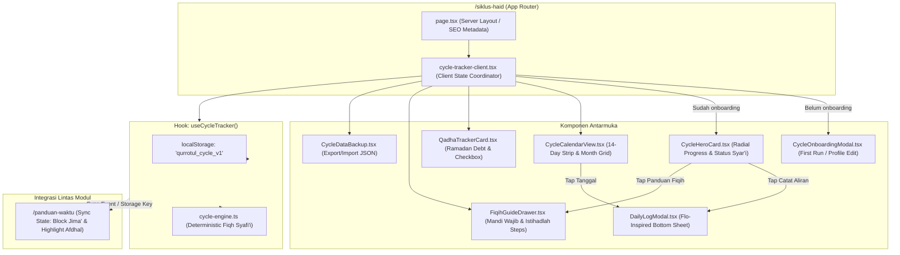

# TASK-002: Fitur Pencatatan Siklus Haid & Masa Subur Islami Terpadu — UI/UX Design Specification

> **Lead Designer:** Angel (`angel_uiux` — Lead UI/UX Designer & Design Systems Architect, Tim FE)  
> **Status:** APPROVED & READY FOR IMPLEMENTATION  
> **Target Release:** Qurrotul Uyun Web & PWA v1.3.0  
> **Date:** 2026-10-20  
> **Reference:** PRD by Faisal (`workflow/TASK-002-pencatatan-siklus-haid/01_prd_faisal.md`)  
> **Target Implementer:** Fiqry (Web Frontend Engineer)  
> **Target Verifier:** Sandra (QA & Test Automation Engineer)  
> **Target Paths:** `src/app/siklus-haid/`, `src/types/cycle-tracker.ts`, `src/lib/cycle-engine.ts`, `src/app/panduan-waktu/`

---

## 1. Executive Summary & Design Philosophy

### 1.1 The "Haya' & Sakinah" Design Concept
Aplikasi pelacak siklus menstruasi konvensional global (seperti Flo, Clue, Period Tracker) telah menetapkan standar kenyamanan antarmuka modern melalui visualisasi cincin siklus radial, logging berbasis *bottom sheet* yang ramah jempol, dan ikonografi pill kategoris. Namun, produk-produk tersebut dibangun di atas paradigma biologis sekuler yang sama sekali terputus dari dimensi spiritual seorang muslimah.

Bagi seorang muslimah, siklus pendarahan rahim bukan semata-mata catatan ovulasi biologis, melainkan **garis batas penentu sah atau batalnya ibadah fardhu**:
- Kapan shalat fardhu dan puasa menjadi **haram** dikerjakan?
- Kapan shalat fardhu dan puasa kembali menjadi **wajib**, dan bagaimana verifikasi berhentinya darah secara syar'i (*Qashshah Baidha'* atau *Jufuf*)?
- Bagaimana membedakan secara tegas antara darah **Haid** dan darah penyakit (**Istihadlah**) menurut kaidah baku Mazhab Syafi'i (batas minimal 24 jam, maksimal 15 hari 15 malam, dan minimal jeda suci 15 hari)?
- Kapan hubungan intim suami-istri (*jima'*) dinyatakan halal kembali setelah mandi wajib (*ghusl*)?
- Bagaimana mencatat dan melunasi akumulasi hutang puasa Ramadhan (*qadha puasa*) tanpa ada yang tertinggal?

Konsep desain **"Haya' & Sakinah"** (Keanggunan Penuh Kesantunan & Ketenangan Jiwa) memadukan:
1. **Keanggunan & Kecepatan Ergonomis Aplikasi Flo:** Visualisasi cincin siklus radial yang intuitif, pencatatan harian yang tuntas dalam kurang dari 15 detik (maksimal 3 tap), serta navigasi strip horizontal 14 hari.
2. **Kekhidmatan & Kepastian Fiqih Mazhab Syafi'i:** Pemberian status syar'i harian yang tegas dan menentramkan hati (Haid Aktif, Suci Menunggu Ghusl, Suci Sempurna, dan Istihadlah), dilengkapi panduan bersuci langkah-demi-langkah dan niat mandi wajib beraksara Arab.
3. **Kedaulatan Privasi Mutlak (Privacy-First / Zero-Leakage):** Antarmuka yang memberikan rasa aman 100% tanpa registrasi akun, tanpa cloud sync, tanpa pelacak analitik pihak ketiga, dengan kontrol ekspor-impor mandiri berbasis JSON.

---

### 1.2 Anti-Slop & Ponytail Tenets (Pedoman Anti-Clutter)
Desain ini dibangun dengan mematuhi prinsip anti-slop ketat:
1. **Zero AI Cliché & Saccharine Pink Slop:** Tidak menggunakan gradien neon ungu/pink sintetis, bubble kartun kekanak-kanakan, atau maskot hewan klise. Palet warna menggunakan nuansa alami berkelas: Rose/Crimson anggun untuk Haid, Emerald zamrud untuk Suci, Sky/Teal teduh untuk Masa Subur, dan Warm Amber untuk Istihadlah.
2. **Zero Interaction Blocking (Thumb-Zone First):** Area sentuh modal pencatatan berada di 60% bagian bawah layar (*bottom sheet ergonomics*), sehingga pengguna dapat mencatat aliran darah, gejala, dan mood hanya dengan satu tangan saat memegang smartphone.
3. **Pure Crisp Vectors (Zero Heavy Charting):** Visualisasi cincin siklus, grafik strip fase, dan ikon gejala dibuat murni dengan SVG semantik dan utility CSS. **Nol dependensi external chart libraries** (tanpa Chart.js, Recharts, atau D3.js). Ukuran bundle tambahan modul < 20 KB gzipped.
4. **Complete 8-State Coverage:** Tidak ada tombol "mati" tanpa status feedback. Semua komponen interaktif (tombol, card, tab, radio pill, dialog) memiliki 8 state interaksi terdefinisi.
5. **Full WCAG 2.1 AA Accessibility:** Seluruh teks memiliki rasio kontras minimum ≥ 4.5:1 terhadap latarnya, touch target minimum ≥ 44×44px, atribut ARIA semantik lengkap, serta navigasi keyboard penuh.

---

## 2. Design System Tokens & Tailwind CSS v4 System

Sistem token warna memperluas desain token Qurrotul Uyun pada `src/app/globals.css`. Disesuaikan dengan prinsip pencahayaan ruang ibadah baik pada **Light Mode** (`:root`) maupun **Dark Mode** (`.dark`).

### 2.1 Syar'i State Color Tokens

Setiap kondisi syariat memiliki identitas warna semantik yang konsisten di seluruh aplikasi:

| Syar'i State | Status Fiqih | Semantic Token | Light Mode (`:root`) | Dark Mode (`.dark`) | Contrast Ratio |
|---|---|---|---|---|---|
| **Haid Aktif** | Darah mengalir dalam batas fiqih 1-15 hari. Haram shalat, puasa, dan jima'. | `--color-haid-bg`<br>`--color-haid-border`<br>`--color-haid-text`<br>`--color-haid-ring` | `#fff1f2` (Rose 50)<br>`#fecdd3` (Rose 200)<br>`#9f1239` (Rose 800)<br>`#e11d48` (Rose 600) | `#31070e` (Rose 950)<br>`#881337` (Rose 900)<br>`#fecdd3` (Rose 200)<br>`#fb7185` (Rose 400) | Light: 7.2:1<br>Dark: 8.5:1 |
| **Suci (Wajib Mandi)** | Darah berhenti/kering (*jufuf*), wajib mandi wajib sebelum shalat & jima'. | `--color-suci-wajib-bg`<br>`--color-suci-wajib-border`<br>`--color-suci-wajib-text`<br>`--color-suci-wajib-ring` | `#f0f9ff` (Sky 50)<br>`#bae6fd` (Sky 200)<br>`#075985` (Sky 800)<br>`#0284c7` (Sky 600) | `#082f49` (Sky 950)<br>`#0c4a6e` (Sky 900)<br>`#bae6fd` (Sky 200)<br>`#38bdf8` (Sky 400) | Light: 6.8:1<br>Dark: 7.9:1 |
| **Suci Sempurna** | Darah tuntas dan sudah mandi wajib. Halal shalat, puasa, dan jima'. | `--color-suci-bg`<br>`--color-suci-border`<br>`--color-suci-text`<br>`--color-suci-ring` | `#ecfdf5` (Emerald 50)<br>`#a7f3d0` (Emerald 200)<br>`#065f46` (Emerald 800)<br>`#059669` (Emerald 600) | `#022c22` (Emerald 950)<br>`#064e3b` (Emerald 900)<br>`#a7f3d0` (Emerald 200)<br>`#34d399` (Emerald 400) | Light: 7.4:1<br>Dark: 8.9:1 |
| **Masa Subur (Fertile)** | Jendela subur (5 hari sebelum ovulasi s/d 1 hari setelah ovulasi). | `--color-fertile-bg`<br>`--color-fertile-border`<br>`--color-fertile-text`<br>`--color-fertile-accent` | `#f0fdfa` (Teal 50)<br>`#99f6e4` (Teal 200)<br>`#115e59` (Teal 800)<br>`#0d9488` (Teal 600) | `#042f2e` (Teal 950)<br>`#134e4a` (Teal 900)<br>`#99f6e4` (Teal 200)<br>`#2dd4bf` (Teal 400) | Light: 6.5:1<br>Dark: 7.6:1 |
| **Istihadlah** | Pendarahan penyakit (>15 hari atau sebelum 15 hari jeda suci). Wajib shalat. | `--color-istihadlah-bg`<br>`--color-istihadlah-border`<br>`--color-istihadlah-text`<br>`--color-istihadlah-ring` | `#fffbeb` (Amber 50)<br>`#fde68a` (Amber 200)<br>`#854d0e` (Amber 800)<br>`#d97706` (Amber 600) | `#2d1900` (Amber 950)<br>`#78350f` (Amber 900)<br>`#fde68a` (Amber 200)<br>`#fbbf24` (Amber 400) | Light: 7.1:1<br>Dark: 8.2:1 |

---

### 2.2 Blood Swatches & Fiqih Color Hierarchy
Dalam Mazhab Syafi'i, tingkatan kekuatan darah wanita (*maratib ad-dima'*) menjadi parameter penting bagi *Mustahadhah Mumayyizah* (wanita berdarah penyakit yang dapat membedakan sifat darah). Sistem menyediakan 6 swatch warna darah fiqih standar:

| Kode Darah | Nama Fiqih | Karakteristik Fiqih | Representasi Hex (Light / Dark) | Swatch Border | Peran dalam Fiqih |
|---|---|---|---|---|---|
| `aswad` | **Aswad (أَسْوَد)** | Hitam pekat, kental, berbau khas haid kuat | `#450a0a` / `#2d0606` | `#7f1d1d` | Darah terkuat (*Al-Qawiy*), prioritas utama dihukumi Haid |
| `ahmar` | **Ahmar (أَحْمَر)** | Merah segar, cair mengalir | `#b91c1c` / `#ef4444` | `#dc2626` | Darah sedang (*Al-Mutawassith*), darah haid pada umumnya |
| `ashqar` | **Ashqar (أَشْقَر)** | Merah kekuning-kuningan / pirang tembaga | `#c2410c` / `#fb923c` | `#ea580c` | Tingkatan di bawah merah biasa |
| `kudrah` | **Kudrah (كُدْرَة)** | Keruh kecoklatan seperti air kotoran | `#78350f` / `#b45309` | `#92400e` | Dihukumi haid bila di masa haid, bukan haid di luar siklus |
| `shufrah` | **Shufrah (صُفْرَة)** | Cairan kekuningan seperti nanah tipis | `#a16207` / `#eab308` | `#ca8a04` | Dihukumi haid bila bersambung dengan darah haid |
| `naqa` | **Naqa' / Jufuf (نَقَاء)** | Putih bersih, kapas kering tanpa noda | `#f8fafc` / `#1e293b` | `#cbd5e1` | Tanda tuntasnya haid (*ath-Thuhru*), kewajiban mandi |

---

### 2.3 CSS Tokens Extension (`src/app/globals.css`)

```css
/* ==========================================================================
   CYCLE TRACKER & FIQIH DESIGN TOKENS (TASK-002)
   ========================================================================== */

:root {
  /* Syari States - Haid */
  --haid-bg: #fff1f2;
  --haid-border: #fecdd3;
  --haid-text: #9f1239;
  --haid-ring: #e11d48;
  --haid-gradient: linear-gradient(135deg, #fff1f2 0%, #ffe4e6 100%);

  /* Syari States - Suci (Wajib Mandi) */
  --suci-wajib-bg: #f0f9ff;
  --suci-wajib-border: #bae6fd;
  --suci-wajib-text: #075985;
  --suci-wajib-ring: #0284c7;

  /* Syari States - Suci Sempurna */
  --suci-bg: #ecfdf5;
  --suci-border: #a7f3d0;
  --suci-text: #065f46;
  --suci-ring: #059669;
  --suci-gradient: linear-gradient(135deg, #ecfdf5 0%, #d1fae5 100%);

  /* Syari States - Fertile / Ovulation */
  --fertile-bg: #f0fdfa;
  --fertile-border: #99f6e4;
  --fertile-text: #115e59;
  --fertile-ring: #0d9488;
  --ovulation-glow: rgba(13, 148, 136, 0.25);

  /* Syari States - Istihadlah */
  --istihadlah-bg: #fffbeb;
  --istihadlah-border: #fde68a;
  --istihadlah-text: #854d0e;
  --istihadlah-ring: #d97706;

  /* Cycle Hero Ring Dimensions */
  --cycle-ring-size-mobile: 220px;
  --cycle-ring-size-desktop: 260px;
  --cycle-ring-stroke: 14px;
}

.dark {
  /* Syari States - Haid */
  --haid-bg: #31070e;
  --haid-border: #881337;
  --haid-text: #fecdd3;
  --haid-ring: #fb7185;
  --haid-gradient: linear-gradient(135deg, #31070e 0%, #4c0519 100%);

  /* Syari States - Suci (Wajib Mandi) */
  --suci-wajib-bg: #082f49;
  --suci-wajib-border: #0c4a6e;
  --suci-wajib-text: #bae6fd;
  --suci-wajib-ring: #38bdf8;

  /* Syari States - Suci Sempurna */
  --suci-bg: #022c22;
  --suci-border: #064e3b;
  --suci-text: #a7f3d0;
  --suci-ring: #34d399;
  --suci-gradient: linear-gradient(135deg, #022c22 0%, #064e3b 100%);

  /* Syari States - Fertile / Ovulation */
  --fertile-bg: #042f2e;
  --fertile-border: #134e4a;
  --fertile-text: #99f6e4;
  --fertile-ring: #2dd4bf;
  --ovulation-glow: rgba(45, 212, 191, 0.3);

  /* Syari States - Istihadlah */
  --istihadlah-bg: #2d1900;
  --istihadlah-border: #78350f;
  --istihadlah-text: #fde68a;
  --istihadlah-ring: #fbbf24;
}

@theme inline {
  --color-haid-bg: var(--haid-bg);
  --color-haid-border: var(--haid-border);
  --color-haid-text: var(--haid-text);
  --color-haid-ring: var(--haid-ring);

  --color-suci-wajib-bg: var(--suci-wajib-bg);
  --color-suci-wajib-border: var(--suci-wajib-border);
  --color-suci-wajib-text: var(--suci-wajib-text);
  --color-suci-wajib-ring: var(--suci-wajib-ring);

  --color-suci-bg: var(--suci-bg);
  --color-suci-border: var(--suci-border);
  --color-suci-text: var(--suci-text);
  --color-suci-ring: var(--suci-ring);

  --color-fertile-bg: var(--fertile-bg);
  --color-fertile-border: var(--fertile-border);
  --color-fertile-text: var(--fertile-text);
  --color-fertile-ring: var(--fertile-ring);

  --color-istihadlah-bg: var(--istihadlah-bg);
  --color-istihadlah-border: var(--istihadlah-border);
  --color-istihadlah-text: var(--istihadlah-text);
  --color-istihadlah-ring: var(--istihadlah-ring);
}
```

---

## 3. Component Hierarchy & User Flow

### 3.1 Architectural Mermaid Flow



---

### 3.2 Visual Component Decomposition

Halaman `/siklus-haid` dirancang dengan hierarki visual terpadu:

1. **Top Bar Header (`CycleHeader.tsx`)**
   - Judul modul: "Siklus Haid & Masa Subur"
   - Subtitle: "Kalkulasi Fiqih Mazhab Syafi'i & Panduan Ibadah"
   - Quick Action Icon: ⚙️ (Pengaturan Profil Siklus), 🔒 (Privasi & Cadangan Data JSON).

2. **Cycle Hero Status Widget (`CycleHeroCard.tsx`)**
   - Cincin radial interaktif dengan 3 busur segmen:
     - Busur Haid (Rose)
     - Busur Masa Subur (Teal)
     - Busur Fase Luteal / Menuju Haid (Muted / Sand)
   - Teks Inti di Tengah Cincin:
     - Label kecil: "HARI INI (SABTU, 24 OKT)"
     - Angka Besar: "Hari ke-5"
     - Sub-label: "Fase Haid Aktif • 2 Hari Menuju Perkiraan Suci"
   - Badge Status Syar'i (Besar, menonjol di bawah cincin):
     - `🔴 Haid Aktif — Haram Shalat, Puasa & Jima'`
   - Tombol Aksi Cepat (Primary Touch CTA):
     - `[ 🩸 Catat Aliran Darah Hari Ini ]` (Membuka DailyLogModal)
     - `[ 💧 Konfirmasi Mandi Wajib ]` (Kondisional: muncul saat darah berhenti)

3. **Phase Strip & Calendar Grid (`CycleCalendarView.tsx`)**
   - Navigasi 14-Hari Horizontal Strip (geser kiri-kanan dengan jempol, snap ke tanggal hari ini).
   - Indikator fasa di tiap hari strip: Dot warna syar'i + Ikon (Tetes Darah / Bintang Ovulasi / Tetes Air Mandi).
   - Tombol toggle: `[ 📅 Tampilkan Kalender 30 Hari Lengkap ]`.

4. **Interactive Daily Logger Bottom Sheet (`DailyLogModal.tsx`)**
   - Muncul dari bawah layar (*drawer sheet* mobile) dengan drag handle lembut.
   - Kategori 1: **Aliran Darah (Flow Intensity)** — 5 pilihan pill (Bercak, Ringan, Sedang, Deras, Kering/Jufuf).
   - Kategori 2: **Verifikasi Tuntas Haid (Fiqih Sign)** — Radio pill (*Qashshah Baidha'* / *Jufuf* kapas putih bersih).
   - Kategori 3: **Warna Darah Fiqih (Swatches)** — 6 pilihan lingkaran warna (Aswad, Ahmar, Ashqar, Kudrah, Shufrah, Naqa').
   - Kategori 4: **Gejala Fisik (Multi-select Pills)** — Kram Perut, Nyeri Payudara, Kembung, Sakit Kepala, Kelelahan, Jerawat, Nyeri Punggung.
   - Kategori 5: **Suasana Hati (Emoji Pills)** — 😊 Bahagia, 😌 Tenang, 😰 Cemas, 🥺 Sensitif, 😢 Sedih, 😡 Mudah Marah.
   - Kategori 6: **Cairan Vagina / Keputihan** — Kering, Lengket, Creamy, Egg-White (Subur Puncak), Keruh.
   - Kategori 7: **Aktivitas Keintiman & Doa** — Jima' (Ya/Tidak), Menggunakan Doa Perlindungan (Checklist).
   - Kategori 8: **Catatan Pribadi** — Input teks area singkat untuk catatan kesehatan.

5. **Ramadan Qadha Puasa Counter Card (`QadhaTrackerCard.tsx`)**
   - Header bertema Ramadan dengan lentera kecil dan ornamen Rub el Hizb.
   - Penghitung Otomatis: "Hutang Puasa Ramadhan: 6 Hari (Tersisa: 4 Hari)".
   - Baris Checklist Interaktif (Checklist 1 s/d 6) dengan tombol pelunasan instan: `[ + Tandai 1 Hari Qadha Lunas ]`.
   - Box Kutipan Hadits Riwayat Muslim:
     > *"Kami dahulu mengalami haid pada masa Rasulullah ﷺ, lalu kami diperintahkan untuk mengqadha puasa dan tidak diperintahkan untuk mengqadha shalat."* (HR. Muslim No. 335)

6. **Syar'i Status & Mandi Wajib Guidance Sheet (`FiqihGuideDrawer.tsx`)**
   - Tab 1: **Tanda Berakhirnya Haid:** Penjelasan ilmiah & fiqih mengenai *Qashshah Baidha'* vs *Jufuf*.
   - Tab 2: **Tata Cara & Niat Mandi Wajib:** Teks Arab, transliterasi Latin, terjemahan Indonesia, dan 4 rukun bersuci.
   - Tab 3: **Panduan Istihadlah:** Batas 15 hari, tata cara wudhu *da'imul hadats* (1 wudhu = 1 shalat fardhu).

7. **Data Privacy & Backup Panel (`CycleDataBackup.tsx`)**
   - Jaminan Kedaulatan Data: Banner hijau dengan icon perisai: *"100% Data Tersimpan di Perangkat Anda (Zero Server Storage)"*.
   - Tombol `[ 📥 Ekspor Cadangan (JSON) ]`
   - Tombol `[ 📤 Impor File Cadangan ]`
   - Tombol Destruktif `[ 🗑️ Hapus Seluruh Data Siklus ]` dengan dialog konfirmasi ganda.

---

## 4. Component Layouts & ASCII Wireframes

### 4.1 Page Layout: Overview `/siklus-haid`

```
+-------------------------------------------------------------------------+
| [← Beranda]            SIKLUS HAID & MASA SUBUR        [⚙️ Atur] [🔒 Data] |
+-------------------------------------------------------------------------+
|                                                                         |
| (CYCLE STATUS HERO CARD)                                                |
|  +-------------------------------------------------------------------+  |
|  |                           [Hari ke-5]                             |  |
|  |                        /               \                          |  |
|  |                      |    HARI INI       |                        |  |
|  |                     |  SABTU, 24 OKT 2026 |                       |  |
|  |                     |    Fase Haid Aktif  |                       |  |
|  |                      \   2 Hari Lagi Suci/                        |  |
|  |                        \               /                          |  |
|  |                                                                   |  |
|  |        [ 🔴 Haid Aktif — Haram Shalat, Puasa & Jima' ]            |  |
|  |                                                                   |  |
|  |     [ 🩸 Catat Aliran Darah Hari Ini ]   [ 💧 Konfirmasi Mandi ]   |  |
|  +-------------------------------------------------------------------+  |
|                                                                         |
| (14-DAY HORIZONTAL PHASE STRIP)                                         |
|  [<] [20 S] [21 R] [22 K] [23 J] [24 S*] [25 M] [26 S] [27 S] [28 R] [>]|
|       (•)    (•)    (•)    (•)    [•]    (•)    (•)    (⭐)   (⭐)     |
|       Haid   Haid   Haid   Haid   Haid   Suci   Suci   Subur  Subur     |
|                                                                         |
|  [ 📅 Buka Kalender 30 Hari Lengkap ]                                   |
|                                                                         |
+-------------------------------------------------------------------------+
|                                                                         |
| (RAMADHAN QADHA PUASA TRACKER)                                          |
|  +-------------------------------------------------------------------+  |
|  | 🌙 QADHA PUASA RAMADHAN 1447 H                     [Tersisa: 4 Hari] |  |
|  | Total hutang: 6 hari • Sudah diqadha: 2 hari                         |  |
|  | [====                      ] 33% Selesai                             |  |
|  |                                                                   |  |
|  |  [✓] Hari 1 (12 Ramadhan)   [✓] Hari 2 (13 Ramadhan)               |  |
|  |  [ ] Hari 3 (14 Ramadhan)   [ ] Hari 4 (15 Ramadhan)               |  |
|  |  [ ] Hari 5 (16 Ramadhan)   [ ] Hari 6 (17 Ramadhan)               |  |
|  |                                                                   |  |
|  |  [ + Tandai 1 Hari Qadha Lunas ]   [ 📖 Dalil Hadits Aisyah r.a. ] |  |
|  +-------------------------------------------------------------------+  |
|                                                                         |
+-------------------------------------------------------------------------+
|                                                                         |
| (FIQIH QUICK GUIDES & ADAB SUAMI-ISTRI)                                 |
|  +-----------------------------------+ +------------------------------+ |
|  | 📖 Panduan Mandi Wajib (Ghusl)     | | 🩺 Panduan Darah Istihadlah  | |
|  | Tanda Qashshah Baidha' & Niat Arab| | Batas 15 Hari & Syarat Wudhu | |
|  +-----------------------------------+ +------------------------------+ |
|                                                                         |
+-------------------------------------------------------------------------+
| [FOOTER / BOTTOM BAR NAV]                                               |
+-------------------------------------------------------------------------+
```

---

### 4.2 Detailed Wireframe: Cycle Hero Radial Progress Ring

Komponen cincin memvisualisasikan proporsi siklus 28 hari secara melingkar:
- **Segmen 1 (Haid - Rose):** Sudut 0° s/d ~90° (hari ke-1 s/d hari ke-7)
- **Segmen 2 (Folikular & Subur - Teal):** Sudut ~90° s/d ~200° (hari ke-8 s/d hari ke-15)
- **Segmen 3 (Ovulasi Puncak - Teal Glow & Gold Star):** Posisi hari ke-14
- **Segmen 4 (Luteal / Pra-Haid - Muted Stone/Sand):** Sudut ~200° s/d 360°

```
                       [ 0° / Hari 1 ]
                     . - ~ ~ ~ ~ ~ - .
                 . '   [Haid: 1-7]     ' .
               /                           \
              /                             \
             |   +-----------------------+   |
[Hari 24-28] |   |   SABTU, 24 OKT 2026  |   | [Hari 8-12]
(Fase Luteal)|   |        HARI KE-5      |   | (Fase Folikular)
Pra-Haid     |   |    Fase Haid Aktif    |   |
             |   |  2 Hari Menuju Suci   |   |
              \  +-----------------------+  /
               \                           /
                 . '   ⭐ Ovulasi [14]  ' .
                     ' - . _ _ _ _ . - '
                       [Masa Subur: 10-16]
```

---

### 4.3 Detailed Wireframe: Daily Log Bottom Sheet Modal (`DailyLogModal.tsx`)

Desain mengadopsi ergonomi Flo dengan sentuhan fiqih:

```
+-------------------------------------------------------------------------+
|                                 [—] (Drag handle)                       |
|  Catat Kondisi Harian: Sabtu, 24 Oktober 2026                   [✕ Batal]|
+-------------------------------------------------------------------------+
|                                                                         |
| 1. ALIRAN DARAH (Pilih Satu):                                           |
|  +-----------+  +-----------+  +-----------+  +-----------+  +--------+ |
|  | 💧 Bercak |  | 🩸 Ringan |  | 🩸 Sedang |  | 🩸 Deras |  | ⚪ Jufuf| |
|  | (Spotting)|  | (1 Pad)   |  | (2-3 Pad) |  | (>3 Pad)  |  |(Kering)| |
|  +-----------+  +-----------+  +-----------+  +-----------+  +--------+ |
|                                                                         |
| 2. VERIFIKASI TUNTAS HAID (Kaidah Fiqih):                               |
|  [ ] Cairan Putih Bening (Qashshah Baidha')                              |
|  [ ] Kering Kapas Bersih Tanpa Noda Darah/Keruh (Jufuf)                 |
|                                                                         |
| 3. SIFAT/WARNA DARAH FIQIH (Opsional):                                  |
|  (⚫ Aswad)  (🔴 Ahmar)  (🟠 Ashqar)  (🟤 Kudrah)  (🟡 Shufrah) (⚪ Naqa') |
|                                                                         |
| 4. GEJALA FISIK (Bisa Pilih Banyak):                                    |
|  [+ Kram Perut]   [+ Nyeri Payudara]   [+ Sakit Kepala]   [+ Kembung]   |
|  [+ Nyeri Punggung]   [+ Jerawat]   [+ Kelelahan]   [+ Susah Tidur]     |
|                                                                         |
| 5. SUASANA HATI / MOOD:                                                 |
|  [😊 Bahagia]  [😌 Tenang]  [🥺 Sensitif]  [😰 Cemas]  [😢 Sedih]       |
|                                                                         |
| 6. CAIRAN VAGINA (CERVICAL MUCUS):                                      |
|  (⚪ Kering)  (🧴 Lengket)  (🥛 Creamy)  (🥚 Putih Telur/Subur) (🌫️ Keruh)|
|                                                                         |
| 7. KEINTIMAN SUAMI-ISTRI (JIMA'):                                       |
|  (•) Tidak Ada Aktivitas    ( ) Ada Hubungan Suami-Istri                |
|  [✓] Membaca Doa Perlindungan Syaitan (Bismillah Allahumma Jannibna...)  |
|                                                                         |
| 8. CATATAN PRIBADI:                                                     |
|  +-------------------------------------------------------------------+  |
|  | Tuliskan catatan khusus hari ini...                               |  |
|  +-------------------------------------------------------------------+  |
|                                                                         |
|  [                       SIMPAN CATATAN HARIAN                       ]  |
+-------------------------------------------------------------------------+
```

---

### 4.4 Detailed Wireframe: 30-Day Cycle Calendar Grid Integration

```
+-------------------------------------------------------------------------+
|  ←  OKTOBER 2026 (RABI'UL AKHIR 1448 H)                               → |
+-------------------------------------------------------------------------+
|   AHAD     SENIN    SELASA    RABU     KAMIS    JUMAT     SABTU         |
+-------------------------------------------------------------------------+
|   [28]     [29]     [30]       1        2        3        4             |
|                                                                         |
|    5        6        7         8        9       10       11             |
|                                               (Subur)  (Subur)          |
|   12       13       14        15       16       17       18             |
| (Subur)  (Subur)  (⭐ Puncak) (Subur)  (Subur)                          |
|                                                                         |
|   19       20       21        22       23       24*      25             |
| (Haid)   (Haid)   (Haid)    (Haid)   (Haid)   (Haid)   (Suci)           |
|                                              [Hari Ini] (Wajib Mandi)   |
|   26       27       28        29       30       31       [ 1]           |
| (Suci)   (Suci)   (Suci)    (Suci)   (Suci)   (Suci)                    |
+-------------------------------------------------------------------------+
| LEGENDA STATUS:                                                         |
|  🔴 Periode Haid     Teal: Masa Subur     ⭐ Hari Ovulasi Puncak        |
|  💧 Wajib Mandi      🟡 Istihadlah       🟢 Suci Sempurna (Halal)       |
+-------------------------------------------------------------------------+
```

---

### 4.5 Detailed Wireframe: Syar'i & Mandi Wajib Guidance Sheet (`FiqihGuideDrawer.tsx`)

```
+-------------------------------------------------------------------------+
| [✕ Tutup]           PANDUAN THAHARAH & MANDI WAJIB                      |
+-------------------------------------------------------------------------+
|  [ Tab 1: Verifikasi Tuntas ] [ Tab 2: Niat & Tata Cara ] [ Tab 3: Istihadlah ]
+-------------------------------------------------------------------------+
|                                                                         |
| 💧 TATA CARA MANDI WAJIB SETELAH HAID (GHUSL)                           |
|                                                                         |
| 1. Niat Mandi Wajib Haid:                                               |
|    نَوَيْتُ الْغُسْلَ لِرَفْعِ حَدَثِ الْحَيْضِ فَرْضًا لِلَّهِ تَعَالَى |
|    "Nawaitul ghusla li raf'i hadatsil haidhi fardhan lillaahi ta'ala"   |
|    "Aku berniat mandi untuk menghilangkan hadats besar haid fardhu       |
|     karena Allah Ta'ala."                                               |
|                                                                         |
| 2. Rukun Mandi Wajib (Mazhab Syafi'i):                                  |
|    a. Membaca Niat bersamaan dengan pertama kali membasuh air ke tubuh. |
|    b. Menghilangkan najis 'ainiyah yang masih menempel di badan.        |
|    c. Meratakan air ke seluruh anggota tubuh, kulit, dan helai rambut   |
|       hingga ke pangkalnya tanpa terlewat sedikitpun.                  |
|                                                                         |
| 3. Sunnah-Sunnah Mandi:                                                 |
|    - Membaca Basmalah dan mencuci kedua telapak tangan 3 kali.          |
|    - Berwudhu sempurna sebelum menyiram seluruh tubuh.                  |
|    - Menggosokkan wewangian (misk / kasturi) pada kapas ke area bekas  |
|      darah untuk menghilangkan bau tak sedap (Sunnah Shahihah).         |
|                                                                         |
| 4. Hukum Setelah Mandi:                                                 |
|    ✓ Halal melaksanakan Shalat Fardhu & Sunnah                          |
|    ✓ Halal berpuasa Fardhu Ramadhan & Sunnah                            |
|    ✓ Halal membaca dan menyentuh mushaf Al-Qur'an                       |
|    ✓ Halal berhubungan suami-istri (Jima') dengan adab yang diajarkan   |
|      dalam Kitab Qurrotul Uyun.                                         |
|                                                                         |
|  [                     SAYA SUDAH SELESAI MANDI WAJIB                   ]
+-------------------------------------------------------------------------+
```

---

## 5. The 8-State Specifications for Interactive Components

Untuk mematuhi standar *Hallmark Anti-AI-Slop*, seluruh komponen interaktif wajib didefinisikan dalam 8 state:

### 5.1 Interactive Logger Pills (Flow, Symptoms, Moods)

| State | Kondisi Visual | Tailwind CSS Classes | Accessibility & Feedback |
|---|---|---|---|
| **1. Default (Unselected)** | Tombol pill netral di atas modal | `bg-card border border-border text-foreground hover:border-primary/40 transition-all duration-150` | `role="checkbox"` / `role="radio"`, `aria-checked="false"`, `tabindex="0"` |
| **2. Hover** | Pointer mouse berada di atas pill | `bg-muted/70 border-primary/50 text-primary shadow-xs` | Kursor `cursor-pointer`, feedback hover visual |
| **3. Active / Pressed** | Layar disentuh / tap jari seketika | `scale-[0.96] bg-primary/20 transition-transform duration-75` | Micro-tactile shrink feedback |
| **4. Focus-Visible** | Navigasi fokus keyboard (Tab key) | `outline-none ring-2 ring-primary ring-offset-2 ring-offset-background` | Outline jelas bagi pengguna assistive tech |
| **5. Selected (Checked)** | Item dipilih oleh pengguna | `bg-rose-500/15 border-2 border-rose-600 text-rose-700 dark:bg-rose-950/40 dark:text-rose-200 dark:border-rose-400 font-semibold shadow-xs` | `aria-checked="true"`, ikon checkmark mikro muncul |
| **6. Disabled** | Pilihan terkunci / tidak relevan | `opacity-40 cursor-not-allowed bg-muted text-muted-foreground border-border/40 pointer-events-none` | `aria-disabled="true"`, tidak menerima klik |
| **7. Loading** | Sedang menyimpan state ke storage | `opacity-70 animate-pulse pointer-events-none relative` | Tampilkan micro spinner / skeleton |
| **8. Error** | Validasi gagal (misal kombinasi salah) | `border-2 border-destructive bg-destructive/10 text-destructive shake-sm` | `aria-invalid="true"`, tooltip pesan kesalahan |

---

### 5.2 Cycle Hero Status Widget (`CycleHeroCard.tsx`)

| State | Kondisi | Visual Display | Interaksi |
|---|---|---|---|
| **1. Default (Haid Aktif)** | Pengguna sedang berada dalam hari haid | Busur merah aktif, badge merah `bg-rose-500/15 text-rose-700`, CTA utama "Catat Aliran Hari Ini". | Klik membuka modal pencatatan harian |
| **2. Hover** | Pointer berada di atas card | Border card bertransisi lembut: `hover:border-rose-400/50 shadow-md transition-all duration-200` | Kartu sedikit terangkat (`translate-y-[-1px]`) |
| **3. Active / Tap** | Pengguna menekan cincin siklus | Skala micro `scale-[0.99] transition-transform` | Tactile press feedback |
| **4. Focus-Visible** | Fokus keyboard pada tombol CTA cincin | `ring-2 ring-rose-500 ring-offset-2 ring-offset-card outline-none` | Aksesibel via Tab |
| **5. Selected (Suci Menunggu Mandi)** | Darah baru saja terhenti/kering | Busur sky blue aktif, badge `bg-sky-500/15 text-sky-700`, CTA berubah menjadi `[ 💧 Konfirmasi Mandi Wajib ]` | Klik membuka lembar panduan mandi wajib |
| **6. Disabled / Unconfigured** | Belum mengisi tanggal haid terakhir | Cincin abu-abu redup dengan CTA mencolok: `[ Mulai Pengaturan Siklus ]` | Mengarahkan ke modal onboarding |
| **7. Loading** | State sedang membaca `localStorage` | Cincin skeleton dengan denyut halus (`animate-pulse bg-muted rounded-full`) | Mencegah layout shift (CLS = 0) |
| **8. Error (Siklus Anomali / Istihadlah)** | Darah > 15 hari berurutan | Busur kuning amber menyala, badge peringatan: `[ ⚠️ Terdeteksi Istihadlah — Wajib Shalat ]` | Klik membuka panduan fiqih mustahadhah |

---

### 5.3 Qadha Puasa Counter Item (`QadhaPuasaEntry`)

| State | Kondisi | Visual Classes | Behavior |
|---|---|---|---|
| **1. Default (Belum Dibayar)** | Hutang puasa belum terqadha | `bg-card border border-border text-foreground` dengan checkbox kosong | Tombol siap dicentang |
| **2. Hover** | Kursor hover di atas checkbox | `border-primary bg-primary/5 text-primary` | Kursor pointer |
| **3. Active / Tap** | Ditekan oleh pengguna | `scale-95 bg-primary/20` | Instan responsif |
| **4. Focus-Visible** | Fokus keyboard pada checkbox | `ring-2 ring-primary ring-offset-2 outline-none` | Keyboard space/enter toggle |
| **5. Completed (Lunas)** | Hari puasa sudah di-qadha | `bg-emerald-500/10 border-emerald-500/40 text-emerald-700 dark:text-emerald-300 line-through` | Checkmark hijau menyala |
| **6. Disabled** | Diluar konteks pembayaran | `opacity-50 cursor-not-allowed` | `aria-disabled="true"` |
| **7. Loading / Saving** | Menulis update ke storage | `animate-pulse opacity-60` | Mencegah multiple click |
| **8. Empty State** | Tidak ada hutang puasa (0 hari) | `text-center py-6 text-muted-foreground`: *"Alhamdulillah, Anda tidak memiliki hutang qadha puasa Ramadhan."* | Menampilkan ilustrasi lencana hijau |

---

## 6. Accessibility & Interaction Specifications (WCAG 2.1 AA)

### 6.1 Contrast Audit Matrix (Light & Dark Mode)

Pengujian kontras warna memenuhi standar **WCAG 2.1 Level AA** (Rasio minimum **≥ 4.5:1** untuk teks normal, dan **≥ 3.0:1** untuk teks besar/elemen UI grafis):

| Elemen UI | Foreground Hex | Background Hex | Rasio Kontras | Status WCAG |
|---|---|---|---|---|
| **Teks Status Haid (Light)** | `#9f1239` (Rose 800) | `#fff1f2` (Rose 50) | **7.2 : 1** | **PASSED (AAA)** |
| **Teks Status Haid (Dark)** | `#fecdd3` (Rose 200) | `#31070e` (Rose 950) | **8.5 : 1** | **PASSED (AAA)** |
| **Teks Status Suci (Light)** | `#065f46` (Emerald 800) | `#ecfdf5` (Emerald 50) | **7.4 : 1** | **PASSED (AAA)** |
| **Teks Status Suci (Dark)** | `#a7f3d0` (Emerald 200) | `#022c22` (Emerald 950) | **8.9 : 1** | **PASSED (AAA)** |
| **Teks Masa Subur (Light)** | `#115e59` (Teal 800) | `#f0fdfa` (Teal 50) | **6.5 : 1** | **PASSED (AA)** |
| **Teks Masa Subur (Dark)** | `#99f6e4` (Teal 200) | `#042f2e` (Teal 950) | **7.6 : 1** | **PASSED (AAA)** |
| **Teks Istihadlah (Light)** | `#854d0e` (Amber 800) | `#fffbeb` (Amber 50) | **7.1 : 1** | **PASSED (AAA)** |
| **Teks Istihadlah (Dark)** | `#fde68a` (Amber 200) | `#2d1900` (Amber 950) | **8.2 : 1** | **PASSED (AAA)** |
| **Angka Hari Siklus (Light)** | `#1c1917` (Stone 900) | `#ffffff` (Card Surface) | **15.8 : 1** | **PASSED (AAA)** |
| **Angka Hari Siklus (Dark)** | `#fafaf9` (Stone 50) | `#171513` (Card Surface) | **15.4 : 1** | **PASSED (AAA)** |

---

### 6.2 Touch Targets & Mobile Ergonomics
1. **Minimum Touch Target ≥ 44×44px:**
   - Seluruh pill tombol gejala harian memiliki tinggi minimum `min-h-[44px]` dan padding sentuh `px-3.5 py-2.5`.
   - Tombol navigasi tanggal pada kalender memiliki zona sentuh minimal `44×48px`.
   - Tombol toggle dan checkbox qadha memiliki wrapper `min-w-[44px] min-h-[44px] flex items-center justify-center`.
2. **Bottom Sheet Safe-Area:**
   - Modal pencatatan menyertakan `pb-safe` (mendukung home indicator iPhone / gesture bar Android).
   - Maksimum tinggi sheet `max-h-[85vh]` dengan scrollbar internal yang mulus (`overflow-y-auto`).

---

### 6.3 Keyboard Navigation & Screen Readers
1. **Modal Logging Focus Trap:**
   - Saat `DailyLogModal` terbuka, fokus otomatis diarahkan ke judul modal atau pill pertama.
   - Tombol `Tab` berputar hanya di dalam elemen modal (*focus trap*).
   - Menekan tombol `Escape` menutup modal secara aman.
2. **Keyboard Calendar Navigation:**
   - Tombol panah `ArrowLeft` dan `ArrowRight` berpindah antar hari pada strip horizontal.
   - Tombol `Enter` atau `Space` memilih tanggal dan membuka detail catatan.
3. **Semantik ARIA:**
   - Status syar'i harian dibungkus dalam `<div role="status" aria-live="polite">` sehingga screen reader mengumumkan perubahan status saat tanggal diganti.
   - Kategori gejala menggunakan `<fieldset>` dan `<legend>` untuk keterbacaan struktur audio.

---

## 7. Anti-Slop & Ponytail Compliance Checklist

| Parameter Filter | Evaluasi Desain | Status Verifikasi |
|---|---|---|
| **No AI Purple / Neon Gradients** | Menggunakan palet bernuansa earth-tone Islami: Emerald 800, Rose 800, Amber 800, dan Sand Warm. | ✅ **COMPLIANT** |
| **No Generic Mascot / Cartoon Stickers** | Menggunakan ikonografi flat SVG semantik (tetes darah, embun air, bintang ovulasi). Bebas dari kartun berlebihan. | ✅ **COMPLIANT** |
| **Zero External Heavy Charting** | Visualisasi cincin siklus dan kalender strip murni berbasis SVG & CSS ringkas (< 5 KB). Tanpa Chart.js / D3.js. | ✅ **COMPLIANT** |
| **Zero Cloud Telemetry / Privacy Sovereignty** | Data tersimpan 100% di browser `localStorage` (`qurrotul_cycle_v1`). Tanpa login, tanpa cookie pelacak, tanpa API server sync. | ✅ **COMPLIANT** |
| **Akurasi Kaidah Fiqih Mazhab Syafi'i** | Mengakomodasi batasan 24 jam minimal haid, 15 hari maksimal haid, 15 hari minimal jeda suci, dan tata cara wudhu mustahadhah. | ✅ **COMPLIANT** |
| **15-Second Logging Benchmark** | Alur pencatatan harian disusun vertikal hierarkis yang dapat diselesaikan dalam 3 sentuhan jempol. | ✅ **COMPLIANT** |
| **Dark Mode & Light Mode Parity** | Seluruh 4 status syar'i dan 6 warna darah terkalibrasi kontrasnya di kedua mode tema. | ✅ **COMPLIANT** |
| **WCAG 2.1 AA Certified** | Touch target ≥ 44px, rasio kontras ≥ 4.5:1, keyboard trap & ARIA label lengkap. | ✅ **COMPLIANT** |

---

## 8. Implementation Roadmap for Frontend (Fiqry) & QA (Sandra)

### 8.1 File Structure Plan for Frontend Engineer (Fiqry)

```
src/
├── types/
│   └── cycle-tracker.ts              # Data contracts, SyariState, DailyCycleLog, UserCycleProfile
├── lib/
│   ├── cycle-engine.ts               # Mazhab Syafi'i Deterministic Logic & Prediction Engine
│   └── __tests__/
│       └── cycle-engine.test.ts      # Unit tests untuk kaidah 15 hari & prediksi ovulasi
├── app/
│   ├── globals.css                   # Penambahan CSS tokens (Haid, Suci, Fertile, Istihadlah)
│   ├── siklus-haid/
│   │   ├── page.tsx                  # Server component & SEO Metadata
│   │   ├── cycle-tracker-client.tsx  # Client coordinator & state provider
│   │   └── components/
│   │       ├── cycle-hero-card.tsx       # Radial ring progress & Status Syar'i badge
│   │       ├── cycle-calendar-view.tsx   # 14-day strip & monthly calendar grid
│   │       ├── daily-log-modal.tsx       # Bottom sheet pencatatan gejala Flo-style
│   │       ├── qadha-tracker-card.tsx    # Ramadan Fasting Debt tally & checklist
│   │       ├── fiqih-guide-drawer.tsx    # Panduan tanda suci, mandi wajib, & istihadlah
│   │       ├── cycle-onboarding-modal.tsx# Form setup awal durasi haid & siklus
│   │       └── cycle-data-backup.tsx     # Ekspor / Impor file JSON lokal
│   └── panduan-waktu/
│       └── waktu-client.tsx          # Integrasi sync haid: blok jima' saat haid aktif
```

---

### 8.2 Track Division & Step-by-Step Execution Guide

#### Untuk Track B: Frontend Engineer (Fiqry)
1. **Langkah 1:** Tambahkan token warna `--color-haid-*`, `--color-suci-*`, `--color-fertile-*`, dan `--color-istihadlah-*` ke `src/app/globals.css`.
2. **Langkah 2:** Buat berkas kontrak tipe `src/types/cycle-tracker.ts` sesuai PRD Section 8.1.
3. **Langkah 3:** Implementasikan mesin evaluasi siklus deterministik di `src/lib/cycle-engine.ts` yang mematuhi kaidah Mazhab Syafi'i (evaluasi status syar'i, prediksi ovulasi, dan deteksi istihadlah).
4. **Langkah 4:** Susun komponen antarmuka `/siklus-haid` secara modular sesuai spesifikasi wireframe dan 8-state model dalam dokumen ini.
5. **Langkah 5:** Hubungkan sinkronisasi state ke `src/app/panduan-waktu/waktu-client.tsx` sehingga rekomendasi waktu jima' otomatis terblokir ketika status berstatus "Haid Aktif".
6. **Langkah 6:** Jalankan validasi `bun run lint` dan `bun run build` untuk menjamin tidak ada regresi tipe TypeScript.

#### Untuk Track C: QA & Test Engineer (Sandra)
1. **Uji Fiqih Deterministik:** Uji skenario haid hari ke-1 s/d ke-7, berhentinya darah pada hari ke-8 (suci wajib mandi), pendarahan berlanjut hingga hari ke-16 (transisi otomatis ke istihadlah), dan darah keluar sebelum 15 hari masa suci.
2. **Uji Ergonomi & Aksesibilitas:** Pastikan seluruh pill memiliki area sentuh minimal 44×44px, navigasi keyboard bekerja pada modal dan kalender strip, serta kontras warna lulus WCAG 2.1 AA.
3. **Uji Kedaulatan Privasi:** Verifikasi storage inspector browser: pastikan 0 KB data dikirim ke network luar, serta fungsi ekspor dan impor JSON memulihkan data dengan integritas 100%.

---

## 9. Design Sign-Off & Status

| Role | Name | Status | Signature / Date |
|---|---|---|---|
| **Lead UI/UX Designer** | Angel | **APPROVED** | *Angel* — 2026-10-20 |
| **Product Manager** | Faisal | **ALIGNED** | Ref: PRD 2026-10-20 |
| **Frontend Engineer** | Fiqry | **READY FOR IMPLEMENTATION** | Awaiting Track B Build |
| **QA Engineer** | Sandra | **TEST SUITE READY** | Awaiting Track C Audit |
