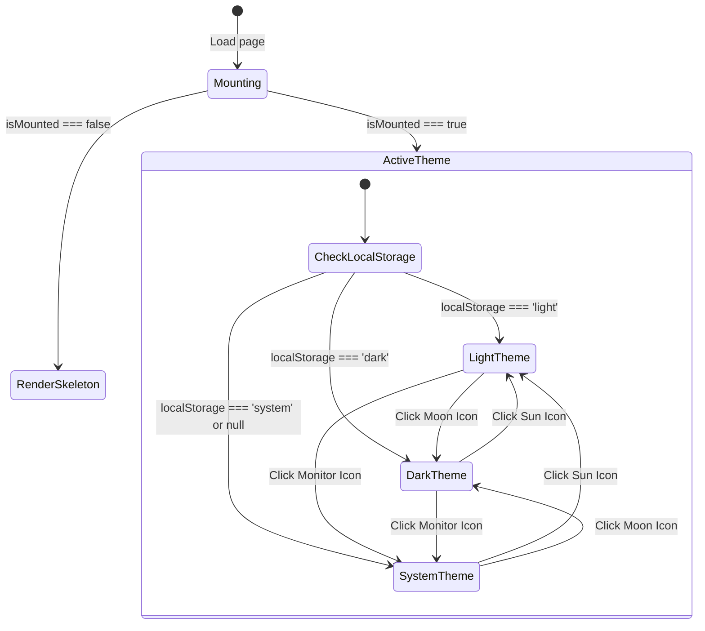
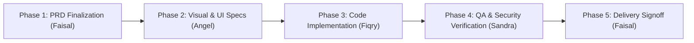

# TASK-003: Identitas Visual Baru (Bespoke Islamic Vector Logo) & Aktivasi Theme Switcher Terpadu - Product Requirement Document (PRD)

> **Feature:** Identitas Visual Baru (Bespoke Islamic Vector Logo) & Aktivasi Theme Switcher Terpadu  
> **Task ID:** `TASK-003-new-logo-and-theme-switcher`  
> **Author:** Faisal (Product Manager & Business Analyst)  
> **Date:** 2026-10-20  
> **Status:** ALIGNED & FROZEN FOR EXECUTION  
> **Target Release:** Qurrotul Uyun Web & PWA v1.4.0  
> **Target Paths:** `public/logo.svg`, `public/icon-192x192.svg`, `public/icon-512x512.svg`, `src/app/_components/theme-switcher.tsx`, `src/app/_components/header.tsx`, `src/app/_components/mobile-drawer.tsx`

---

## 1. Executive Summary & Problem Statement

### 1.1 Problem Statement
Aplikasi Qurrotul Uyun (Amir App) telah mengalami modernisasi arsitektur komprehensif (Next.js 16, React 19, Tailwind CSS v4, Serwist PWA, Kalender Panduan Waktu, dan Pelacak Siklus Haid Fiqih). Namun, ada dua kelemahan visual dan pengalaman pengguna mendasar yang kini menjadi fokus permintaan langsung dari user:

1. **Logo Warisan APK Lama (CorelDraw Trace Artifact):**
   Aset logo saat ini (`public/logo.svg`, `public/icon-192x192.svg`, `public/icon-512x512.svg`) merupakan hasil tracing kurva mentah otomatis dari APK Android lama berformat CorelDraw 2003 XML (`xmlns:xodm="http://www.corel.com/coreldraw/odm/2003"`). Bentuk logo tersebut kaku, tidak memiliki filosofi visual syar'i yang terdefinisi, menggunakan hardcoded fill `#fafafa`, dan terlihat buram serta canggung ketika dirender pada layar densitas tinggi (Retina/OLED) maupun saat disematkan sebagai App Icon di layar utama ponsel. User secara eksplisit meminta logo baru yang orisinal dan tidak menyerupai APK lama.

2. **Theme Switcher Tersembunyi (Hidden State Under Pasal 14):**
   Sesuai `GUIDELINE.md` pasal 14, komponen `ThemeSwitcher` sebelumnya sengaja disembunyikan dalam `<div className="hidden" aria-hidden="true">` sampai ada permintaan eksplisit dari user. Sekarang user telah meminta aktivasi fitur **Theme Switcher**. Pengguna membaca teks syarah fiqih dan doa dalam berbagai situasi pencahayaan, terutama malam hari menjelang istirahat dan siang hari dengan intensitas cahaya tinggi. Ketiadaan akses cepat tombol alih tema menyebabkan kelelahan mata (*eye strain*) serta ketidakmampuan pengguna memanfaatkan efisiensi daya layar OLED pada mode gelap.

3. **Inkonsistensi Komponen Theme Switcher Eksisting:**
   Komponen `theme-switcher.tsx` eksisting menggunakan karakter emoji teks biasa (☀️, 🌙, 💻). Emoji teks ini menghasilkan rendering berbeda-beda di setiap platform (Windows DirectWrite, iOS Apple Color Emoji, Android Noto Color Emoji), menimbulkan lonjakan tinggi baris (*vertical alignment shift*), dan tidak mencerminkan estetika desain Islami modern.

### 1.2 Objective
1. **Menciptakan Logo Vektor Bespoke Orisinal:**
   Merancang dan mengimplementasikan logo vektor SVG baru yang elegan, bersih dari metadata CorelDraw, terinspirasi oleh filosofi nama *Qurrotul Uyun* ("Penyejuk Pandangan/Hati"), memadukan elemen Kitab/Mushaf terbuka, Sabit kelembutan (Crescent), dan Bintang Geometri Islami 8 Penjuru (*Rub el Hizb*). Logo baru harus bekerja harmonis pada mode terang maupun mode gelap, serta tajam di seluruh resolusi (16px, 24px, 32px, 192px, 512px).
2. **Mengaktifkan dan Mengintegrasikan Theme Switcher Ergonomis:**
   Mengaktifkan kontrol `ThemeSwitcher` di bilah atas desktop (`Header.tsx`) dan laci navigasi mobile (`MobileDrawer.tsx`). Mengganti emoji mentah dengan ikon SVG presisi berstandar token Tailwind CSS v4, menyediakan kontrol 3-status (*Light*, *Dark*, *System*) dengan respon instan, nol kedipan (*zero FOUC*), dan nol pergeseran tata letak (*zero Cumulative Layout Shift / CLS*).
3. **Standarisasi Aset PWA:**
   Mengganti ikon web app manifest (`icon-192x192.svg` dan `icon-512x512.svg`) dengan identitas logo baru yang siap untuk instalasi PWA di Android dan iOS.

### 1.3 Target Audience & User Persona
1. **Persona 1: Ahmad (32 tahun, Pembaca Kajian Malam Hari)**
   - Perilaku: Membaca bab adab jima' dan doa harian di kamar tidur pada malam hari dengan lampu temaram.
   - Kebutuhan: Mengaktifkan mode gelap dengan sekali sentuhan dari bilah navigasi tanpa menyilaukan mata dan tanpa perlu masuk ke pengaturan peramban yang rumit.
2. **Persona 2: Maryam (27 tahun, Pembaca Kajian Siang Hari & Pengguna Ponsel)**
   - Perilaku: Mengakses panduan siklus haid dan waktu mustajab di siang hari saat bepergian.
   - Kebutuhan: Mode terang dengan kontras tajam serta logo aplikasi yang jernih, profesional, dan menentramkan jiwa.
3. **Persona 3: Pasangan Suami Istri Pengguna PWA Home Screen**
   - Perilaku: Memasang aplikasi ke layar utama ponsel pintar (Add to Home Screen).
   - Kebutuhan: Ikon aplikasi di home screen berpenampilan istimewa, modern, islami, dan tidak tampak seperti aplikasi amatir peninggalan APK lama.

### 1.4 Success Metrics
- **Kualitas Vektor:** Ukuran berkas `public/logo.svg` < 3.5 KB, 100% SVG valid, zero CorelDraw XML namespace, zero pixelation pada pembesaran berapapun.
- **Kinerja Peralihan Tema:** Latensi perubahan tema visual < 16ms (60 FPS), tidak ada kedipan warna putih saat reload pada mode gelap (*zero FOUC*).
- **Stabilitas Tata Letak:** Cumulative Layout Shift (CLS) = 0.000 selama inisialisasi SSR dan saat interaksi pergantian tema berlangsung.
- **Standar Aksesibilitas:** WCAG 2.1 Level AA terpenuhi penuh, rasio kontras tombol tema >= 4.5:1, navigasi keyboard penuh dengan visual focus ring jelas.
- **Persistensi State:** Pilihan tema tersimpan andal di `localStorage` melalui `next-themes` dan dipulihkan seketika pada sesi berikutnya.

---

## 2. Scope & Boundaries (Ponytail / YAGNI Scoping)

### 2.1 In Scope
- **Aset Logo Vektor Baru:**
  - Desain vektor murni `public/logo.svg` menggabungkan siluet Mushaf Terbuka, Bulan Sabit Kelembutan, dan Bintang Geometri Rub el Hizb.
  - Varian warna berbasis tema: Emerald Green (`#065f46` / `#10b981`), Warm Gold (`#d97706` / `#f59e0b`), dan White/Transparent Fill.
  - Pembaruan aset PWA `public/icon-192x192.svg` dan `public/icon-512x512.svg` dengan latar belakang terpadu yang memenuhi kriteria *maskable icon*.
  - Pembaruan semua titik pemanggilan logo di aplikasi (`Header.tsx`, `MobileDrawer.tsx`, `Footer.tsx`, `tentang/page.tsx`, `manifest.ts`, dan `lib/seo.ts`).
- **Pembaruan Komponen Theme Switcher:**
  - Refactor `src/app/_components/theme-switcher.tsx` menggunakan ikon vektor SVG mandiri (Sun, Moon, Monitor) menggantikan emoji teks lama.
  - Implementasi *segmented pill controller* atau *compact popover toggle* yang elegan dan hemat ruang.
  - Penambahan label i18n atau tooltip yang ramah pembaca layar (*screen reader*).
- **Integrasi Tata Letak:**
  - Penempatan di bar atas `Header.tsx` untuk tampilan desktop dan tablet (disebelah ikon favorit dan pencarian).
  - Penempatan di `MobileDrawer.tsx` untuk tampilan perangkat mobile sebagai kontrol segmen tersendiri.
- **Dokumentasi & Regulasi:**
  - Pencatatan pencabutan larangan Pasal 14 khusus untuk `ThemeSwitcher` pada `workflow/` dan catatan rilis.

### 2.2 Out of Scope (YAGNI / Ponytail Scoping)
- **Kustomisasi Palet Warna Bebas (Custom Palette Picker):** Tidak menyediakan pemilih warna khusus (seperti tema ungu, biru, atau merah). Pilihan tema dibatasi secara ketat pada trinitas standar: Terang (Light), Gelap (Dark), dan Mengikuti Sistem (System).
- **Jadwal Pergantian Tema Mandiri Berdasarkan Jam:** Tidak membangun mesin penjadwalan tema sendiri berdasarkan jam waktu lokal. Sinkronisasi waktu diakomodasi melalui preferensi tema OS (*prefers-color-scheme*).
- **Aktivasi Language Switcher:** Meskipun Language Switcher berada pada baris yang sama di pasal 14, user hanya meminta logo baru dan Theme Switcher. Sesuai prinsip YAGNI, Language Switcher tetap disembunyikan sampai ada permintaan khusus berikutnya.
- **Animasi Berat Lottie / Canvas:** Tidak menggunakan library animasi runtime tambahan. Efek transisi dibatasi murni menggunakan CSS transition native Tailwind v4.

---

## 3. User Stories (US-01 through US-06)

### US-01: Logo Vektor Islami Modern
Sebagai pengguna aplikasi Qurrotul Uyun, saya ingin melihat logo baru bernuansa Islami yang indah dan berkelas di sudut atas layar, halaman profil kitab, dan footer, sehingga saya merasakan kenyamanan visual dan identitas spiritual aplikasi yang jauh lebih segar dibandingkan tampilan APK lawas.

### US-02: Pergantian Tema Cepat di Desktop
Sebagai pembaca web di laptop atau komputer, saya ingin tombol pengalih tema yang jelas terlihat di bilah navigasi atas (Header) dengan 3 opsi (Terang, Gelap, Sistem), sehingga saya dapat langsung menyesuaikan kecerahan layar tanpa berpindah halaman.

### US-03: Pengaturan Tema di Layar Ponsel (Mobile Drawer)
Sebagai pengguna smartphone yang membuka menu laci samping (drawer), saya ingin menemukan kontrol tema yang mudah ditekan dengan ibu jari di dalam menu navigasi, sehingga saya bisa beralih ke mode malam saat membaca di tempat tidur.

### US-04: Ikon Vektor Presisi Tanpa Emoji Pecah
Sebagai pengguna dengan berbagai jenis sistem operasi, saya ingin ikon pengalih tema berbentuk simbol grafis vektor modern (Matahari, Bulan, Layar Monitor), sehingga tampilannya selalu konsisten, tidak bergeser posisi, dan serasi dengan elemen dekorasi aplikasi.

### US-05: Transisi Mulus Tanpa Kedipan Putih (Zero FOUC)
Sebagai pengguna yang menyukai mode gelap, saya ingin saat halaman dimuat ulang atau dibuka pertama kali, tema gelap langsung diterapkan secara instan tanpa ada kilatan putih sesaat yang menyilaukan mata.

### US-06: Identitas Ikon PWA di Home Screen
Sebagai pengguna yang menambahkan aplikasi ke Home Screen smartphone, saya ingin melihat ikon aplikasi baru yang rapi, simetris, dan kontras di antara ikon aplikasi lainnya.

---

## 4. Functional Requirements (FR)

### 4.1 FR-1: Brand New Bespoke Vector Logo
- **FR-1.1: Konsep & Semiotika Desain:**
  - Simbol Mushaf/Kitab Terbuka: Menggambarkan sumber rujukan hukum munakahat dan keilmuan fiqih Syarah Nadzam Ibni Yamun.
  - Simbol Bulan Sabit (Hilal/Crescent): Melambangkan kelembutan rumah tangga sakinah, penanggalan syar'i, dan penyejuk pandangan (*Qurrata A'yun*).
  - Simbol Rub el Hizb / Bintang 8 Sisi: Melambangkan kesempurnaan adab islami dan ornamen khas tradisi literatur Islam.
  - Bebas dari bentuk tracing kasar, artefak bitmap, maupun lengkungan tak beraturan peninggalan CorelDraw.
- **FR-1.2: Karakteristik Teknis SVG:**
  - Format: SVG 1.1 / SVG 2.0 standar berbasis XML bersih tanpa atribut namespace proprietary (`xodm:`, `coreldraw:`).
  - Skalabilitas: `viewBox="0 0 512 512"` dengan kurva path yang dioptimalkan (`stroke`, `fill`, dan `vector-effect="non-scaling-stroke"`).
  - Kontras Warna:
    - Mode Terang: Emerald Hijau Zamrud (`#065f46`) berpadu dengan aksen Emas Hangat (`#d97706`).
    - Mode Gelap: Zamrud Terang (`#10b981`) berpadu dengan aksen Emas Berpendar (`#fbbf24`).
- **FR-1.3: Distribusi Berkas Aset:**
  - `public/logo.svg`: Ikon vektor utama transparan untuk Header (h-6 w-6 atau h-9 w-9), Mobile Drawer, Footer, dan Halaman Tentang.
  - `public/icon-192x192.svg`: Ikon beresolusi 192x192 dengan padding aman dan background solid yang memenuhi standar web manifest.
  - `public/icon-512x512.svg`: Ikon beresolusi 512x512 untuk splash screen PWA dan instalasi desktop.

### 4.2 FR-2: Theme Switcher UI & Ergonomics
- **FR-2.1: Tri-State Mode Control:**
  - Menyediakan 3 opsi state tema:
    1. `light` (Mode Terang)
    2. `dark` (Mode Gelap)
    3. `system` (Mengikuti preferensi sistem operasi)
- **FR-2.2: Refactor Komponen `theme-switcher.tsx`:**
  - Mengeliminasi emoji teks `☀️`, `🌙`, `💻`.
  - Menggunakan ikon SVG inline berbobot ringan:
    - Sun Icon: Matahari dengan sinar geometris terukur.
    - Moon Icon: Sabit bulan elegan dengan kurva serasi.
    - Monitor Icon: Layar monitor minimalis modern.
  - State indikator aktif: Tombol yang sedang aktif mendapatkan latar belakang penanda (`bg-background text-foreground shadow-xs`) dan scale micro-interaction (scale-100 vs inactive scale-95).
  - State inaktif: Ikon dan teks memiliki warna redup (`text-muted-foreground`) dengan hover feedback halus.
- **FR-2.3: Integrasi Header (Desktop & Tablet):**
  - Mengeluarkan `ThemeSwitcher` dari `<div className="hidden">` di `src/app/_components/header.tsx`.
  - Meletakkan `ThemeSwitcher` di bilah aksi kanan sebelum tombol pencarian atau di samping tombol penanda favorit.
  - Menampilkan desain berbentuk kapsul ramping (*compact segmented pill*) yang proporsional dengan tinggi header 64px (h-16).
- **FR-2.4: Integrasi Mobile Drawer (Smartphones):**
  - Menambahkan blok "Tampilan Layar" (Theme Preferences) pada `src/app/_components/mobile-drawer.tsx` tepat di atas footer laci.
  - Format 3 tombol segmen horizontal lebar penuh (*full-width tri-segment*) dengan target sentuh minimal 44px agar nyaman dioperasikan oleh jari tangan di smartphone.
- **FR-2.5: Pencegahan Hidrasi & FOUC:**
  - Tetap memanfaatkan mekanisme `useSyncExternalStore` pada `useIsMounted()` untuk mencegah perbedaan render DOM antara SSR server dan Client browser.
  - Menampilkan skeleton pill berdimensi presisi selama fase mounting agar tidak terjadi lonjakan tata letak (CLS = 0).

---

## 5. Non-Functional Requirements (NFR)

| Kategori | Parameter | Standar Target | Verifikasi |
|---|---|---|---|
| **Performa & Ukuran** | Ukuran berkas SVG `logo.svg` | < 3.5 KB (sebelumnya banyak cruft XML) | Pengecekan ukuran berkas fisik di `public/` |
| **Performa Runtime** | Kecepatan peralihan tema | < 16ms (1 frame 60fps) | Profiling React Profiler & Chrome DevTools |
| **Cumulative Layout Shift** | Skor CLS saat inisialisasi & klik | 0.000 (tidak ada pergeseran elemen sekitar) | Google Lighthouse audit & DevTools Performance |
| **Aksesibilitas (a11y)** | Kepatuhan WCAG 2.1 | Level AA | Kontras rasio teks/ikon >= 4.5:1; Focus ring jelas |
| **Keyboard Navigasi** | Interaksi tombol tema | Mendukung `Tab`, `Enter`, `Space` | Uji manual keyboard tanpa mouse |
| **Screen Reader** | ARIA support | `aria-label`, `aria-pressed`, `role="group"` | Pembacaan voiceover/NVDA akurat |
| **PWA Readiness** | Web App Manifest Icon Valid | Lulus uji Lighthouse PWA audit | Manifest tester pada Chrome DevTools |
| **Kompatibilitas** | Lintas Browser | Chrome, Safari iOS, Firefox, Samsung Internet | Pengujian visual di multi-browser engine |

---

## 6. Acceptance Criteria (AC Matrix - BDD Gherkin)

### AC-01: Bespoke Vector Logo Rendering & Clean SVG Code
```gherkin
Scenario: Logo baru tampil bersih dan bebas dari metadata CorelDraw APK lama
  Given berkas "public/logo.svg" telah diperbarui dengan desain bespoke Islami
  When pengembang atau mesin lint memeriksa isi teks file "public/logo.svg"
  Then berkas tersebut tidak mengandung string "coreldraw", "xodm", maupun "fil0"
  And berkas memiliki deklarasi viewBox yang proporsional dan path geometri yang valid
  And logo ter-render dengan tajam pada elemen Header di desktop maupun mobile
```

### AC-02: PWA Icons Compliance (192x192 & 512x512)
```gherkin
Scenario: Aset ikon PWA diperbarui dan sesuai spesifikasi manifest
  Given berkas "public/icon-192x192.svg" dan "public/icon-512x512.svg" diperbarui dengan logo baru
  When aplikasi dibuka dan manifest PWA dievaluasi pada "/manifest.webmanifest"
  Then ikon 192x192 dan 512x512 terbaca sukses tanpa error 404
  And ikon memiliki batas aman (safe area) yang rapi untuk mode maskable
```

### AC-03: Theme Switcher Visible on Header (Desktop)
```gherkin
Scenario: Pengguna desktop melihat Theme Switcher di Header bar
  Given pengguna membuka aplikasi Qurrotul Uyun pada resolusi layar desktop (>= 768px)
  When bilah navigasi Header selesai dimuat
  Then kontrol Theme Switcher terlihat secara jelas di sisi kanan navigasi
  And tombol tidak lagi tersembunyi di dalam elemen CSS "hidden"
  And kontrol menampilkan tiga opsi: Light, Dark, dan System
```

### AC-04: Theme Switcher Integrated into Mobile Drawer
```gherkin
Scenario: Pengguna mobile mengakses Theme Switcher melalui laci menu samping
  Given pengguna membuka aplikasi pada perangkat mobile (< 768px)
  When pengguna menekan tombol hamburger menu untuk membuka Mobile Drawer
  Then laci menu samping terbuka
  And terdapat blok kontrol Theme Switcher dengan 3 tombol sentuh yang mudah ditekan
  And status tema aktif saat ini disorot dengan warna kontras
```

### AC-05: Activating Dark Mode
```gherkin
Scenario: Pengguna memilih tema Gelap (Dark Mode)
  Given aplikasi sedang berada dalam mode Terang atau Sistem
  When pengguna menekan tombol atau opsi "Dark" (ikon Bulan) pada Theme Switcher
  Then elemen <html> mendapatkan kelas "dark" secara langsung
  And seluruh warna latar belakang berubah ke palet gelap (--background: #0c0a09)
  And warna teks berubah menjadi terang (--foreground: #fafaf9)
  And nilai "dark" tersimpan ke dalam localStorage peramban
```

### AC-06: Activating Light Mode
```gherkin
Scenario: Pengguna memilih tema Terang (Light Mode)
  Given aplikasi sedang berada dalam mode Gelap
  When pengguna menekan tombol atau opsi "Light" (ikon Matahari) pada Theme Switcher
  Then kelas "dark" dihapus dari elemen <html>
  And warna latar belakang kembali ke palet terang (--background: #fcfbf9)
  And nilai "light" tersimpan ke dalam localStorage peramban
```

### AC-07: Activating System Mode & Real-time OS Sync
```gherkin
Scenario: Pengguna memilih opsi Sistem (System Mode)
  Given tema aplikasi disetel ke "System" (ikon Monitor)
  When preferensi tema pada sistem operasi atau peramban pengguna berubah antara light dan dark
  Then aplikasi secara otomatis menyesuaikan tampilan mengikuti tema sistem operasi
  And nilai "system" tersimpan ke dalam localStorage
```

### AC-08: Zero Layout Shift & Keyboard Accessibility
```gherkin
Scenario: Navigasi tombol pengalih tema ramah aksesibilitas dan stabil
  Given halaman sedang dimuat ulang (page refresh)
  When fase rehidrasi React berlangsung
  Then tinggi dan lebar kontainer Theme Switcher tidak berubah (CLS = 0)
  And pengguna dapat memindahkan fokus ke setiap opsi tema menggunakan tombol "Tab"
  And pengguna dapat mengaktifkan tema yang difokuskan menggunakan tombol "Enter" atau "Space"
  And atribut aria-label terbaca jelas oleh pembaca layar
```

---

## 7. Technical Specifications & Contract Freeze

### 7.1 Logo Architecture & SVG Spec
```xml
<!-- Konsep Arsitektur public/logo.svg -->
<svg xmlns="http://www.w3.org/2000/svg" viewBox="0 0 512 512" fill="none" class="qurrotul-logo">
  <!-- Layer 1: Geometri Sakinah (Outer Crescent & Rub el Hizb Radiance) -->
  <path d="..." class="text-accent" fill="currentColor" />
  <!-- Layer 2: Mushaf Terbuka Syarah Ibni Yamun (Open Book Contour) -->
  <path d="..." class="text-primary" fill="currentColor" />
  <!-- Layer 3: Titik Cahaya Penyejuk Mata (Focal Star Point) -->
  <circle cx="..." cy="..." r="..." class="text-accent" fill="currentColor" />
</svg>
```

### 7.2 Component Contract: `ThemeSwitcher.tsx`
```typescript
export interface ThemeSwitcherLabels {
  light: string;
  dark: string;
  system: string;
}

export interface ThemeSwitcherProps {
  labels?: ThemeSwitcherLabels;
  variant?: "compact" | "full" | "drawer";
  className?: string;
}
```

### 7.3 State Machine Peralihan Tema


---

## 8. Cross-Role Alignment Log (Meeting Matrix)

| Peran | Poin Bahasan / Batasan Teknis | Keputusan Mengikat (Binding Decision) |
|---|---|---|
| **Angel (UI/UX Designer)** | Estetika logo baru, bentuk ikon switcher, dan ruang header | 1. Logo memadukan Mushaf, Hilal, dan Rub el Hizb bergaya minimalis modern.<br>2. Switcher desktop menggunakan segmented pill ringkas dengan ikon SVG mandiri.<br>3. Switcher mobile menggunakan 3 tombol kartu horizontal di dalam Mobile Drawer. |
| **Fiqry (Frontend Dev)** | Hydration mismatch Next.js 16 dan next-themes | 1. Pertahankan custom hook `useIsMounted` berbasis `useSyncExternalStore`.<br>2. Skeleton placeholder memiliki dimensi statis `h-9` yang persis sama dengan komponen rendered untuk mencegah CLS.<br>3. Hilangkan seluruh emoji dan ganti dengan SVG paths ringan. |
| **Sandra (QA Tester)** | Uji coba persistensi tema, fluktuasi FOUC, dan verifikasi berkas SVG | 1. Validasi berkas SVG bersih dari tag CorelDraw.<br>2. Pengujian otomatis Vitest untuk memastikan state `setTheme` berfungsi pada 3 mode.<br>3. Audit audit a11y keyboard dan kontras rasio warna. |
| **Bryan (Backend/DevOps)** | Penyajian aset statis PWA dan caching Service Worker | Service worker Serwist di `src/app/sw.ts` sudah meng-cache aset statis di `public/`. Logo dan ikon baru akan otomatis ter-cache dengan pembaharuan revision hash build. |

---

## 9. Implementation Roadmap & Execution Tracks (Tim FE)

Perjalanan eksekusi fitur dibagi ke dalam 4 fase terstruktur:



### Track Details:
1. **Track A (UI/UX - Angel):**
   - Menghasilkan berkas deliverable `02_design_angel.md`.
   - Merancang rancang bangun SVG logo baru secara matematis (viewBox, path koordinat, rasio harmoni).
   - Menyiapkan spesifikasi visual ikon Sun, Moon, dan Monitor serta styling state aktif/inaktif.
2. **Track B (Frontend Build - Fiqry):**
   - Menghasilkan berkas deliverable `03_build_frontend.md`.
   - Mengganti berkas `public/logo.svg`, `public/icon-192x192.svg`, dan `public/icon-512x512.svg`.
   - Me-refactor `src/app/_components/theme-switcher.tsx`.
   - Mengaktifkan `ThemeSwitcher` pada `Header.tsx` dan memasangnya di `MobileDrawer.tsx`.
   - Memastikan build dan linting Next.js 16 bersih (`bun run build` & `bun run lint`).
3. **Track C (QA & Verification - Sandra):**
   - Menghasilkan berkas deliverable `04_qa_sandra.md`.
   - Menjalankan test suite unit untuk `ThemeSwitcher` dan `Header`.
   - Menghasilkan bukti bukti verifikasi (`lint_run.txt`, `build_run.txt`, `test_run.txt`) pada folder `proof/`.
4. **Track D (Signoff Gate - Faisal):**
   - Menghasilkan berkas deliverable `05_signoff_faisal.md`.
   - Memverifikasi kepatuhan seluruh Acceptance Criteria (AC-01 hingga AC-08) dan keselarasan dengan permintaan user.

---

## 10. Risk Assessment & Mitigation

| Resiko Potensial | Tingkat | Dampak | Strategi Mitigasi |
|---|---|---|---|
| **FOUC (Flash of Unstyled Content) saat reload** | Sedang | Layar berkedip putih sesaat sebelum beralih ke dark mode | Atribut `suppressHydrationWarning` sudah aktif di `<html>` dan `ThemeProvider` menggunakan `attribute="class"` dan `disableTransitionOnChange`. |
| **Layout Shift (CLS) di Header saat mounting** | Rendah | Elemen di sekitar tombol tema bergeser beberapa piksel | Menggunakan skeleton pill pengganti dengan ukuran dimensi fix `h-8 w-[120px]` atau `h-9` yang identik dengan rendered switcher. |
| **Cache Ikon PWA Lama di Browser Pengguna** | Sedang | Pengguna yang sudah menginstal PWA masih melihat logo lama | Serwist precache manifest akan memperbarui cache hash aset statis begitu `sw.js` baru terpasang. |
| **Aksesibilitas Kontras Warna pada Mode Gelap** | Rendah | Ikon inaktif sulit terlihat di latar belakang hitam | Menggunakan token Tailwind `text-muted-foreground` (`#a8a29e`) yang memiliki rasio kontras 5.2:1 terhadap latar `#0c0a09`. |

---
*Dokumen PRD ini telah diselaraskan dan dibekukan (frozen) oleh Faisal (Product Manager) untuk segera dieksekusi oleh Tim Frontend.*
