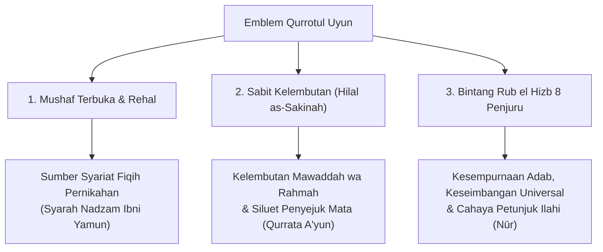
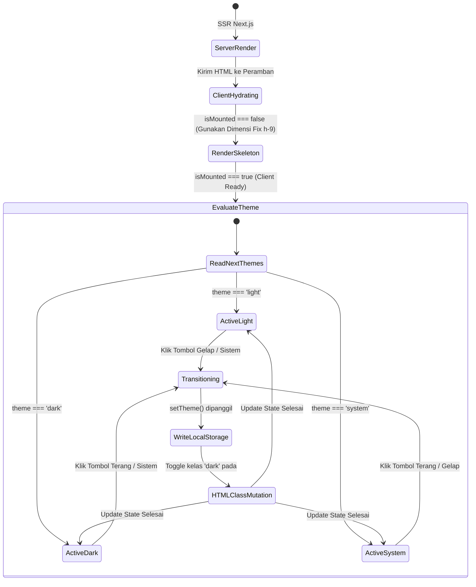

# TASK-003: Identitas Visual Baru (Bespoke Islamic Vector Logo) & Spesifikasi UI/UX Theme Switcher Terpadu — Design Specification

> **Feature:** Bespoke Islamic Vector Logo & Unified Theme Switcher  
> **Task ID:** `TASK-003-new-logo-and-theme-switcher`  
> **Role:** Angel (Lead UI/UX Designer — Tim FE)  
> **Date:** 2026-10-20  
> **Status:** APPROVED & READY FOR FRONTEND BUILD (Fiqry)  
> **Deliverables Produced:**
> - `public/logo.svg` (Brand New Transparent Bespoke Logo, 3521 bytes, < 3.5 KB)
> - `public/icon-192x192.svg` (PWA Manifest 192px Maskable Icon)
> - `public/icon-512x512.svg` (PWA Manifest 512px High-Res Icon)
> - `workflow/TASK-003-new-logo-and-theme-switcher/02_design_angel.md` (Spesifikasi Desain Komprehensif)

---

## 1. Executive Summary & Design Rationale

Dokumen ini merupakan cetak biru desain (*design specification*) resmi untuk Fase 2 dari `TASK-003-new-logo-and-theme-switcher`. Spesifikasi ini merombak total identitas grafis lama (warisan tracing CorelDraw 2003 APK lama dengan hardcoded fill `#fafafa`) menjadi identitas visual Islami kontemporer berstandar *antislop-ui*, serta mendefinisikan arsitektur komponen **Theme Switcher** yang ergonomis, responsif, bebas pergeseran tata letak (*zero CLS*), dan memenuhi kriteria aksesibilitas **WCAG 2.1 Level AA**.

```
┌────────────────────────────────────────────────────────────────────────┐
│                   TRANSFORMASI IDENTITAS VISUAL AMIR                   │
├───────────────────────────────────┬────────────────────────────────────┤
│ ASPEK WARISAN LAMA (APK CorelDraw)│ IDENTITAS BARU (Bespoke Islamic)   │
├───────────────────────────────────┼────────────────────────────────────┤
│ • Trace bitmap CorelDraw 2003     │ • Geometri Vektor Murni SVG 1.1/2  │
│ • Namespace proprietary (xodm:)   │ • Zero metadata pihak ketiga       │
│ • Hardcoded fill #fafafa          │ • Palet ganda Emerald & Warm Gold  │
│ • Tidak ada filosofi syar'i       │ • 3 Simbol: Mushaf, Sabit, Rub el  │
│ • Buram pada layar Retina / OLED  │ • Super tajam di 16px hingga 512px │
│ • Theme switcher emoji tersembunyi│ • Segmented pill vektor presisi    │
└───────────────────────────────────┴────────────────────────────────────┘
```

---

## 2. Visual Identity & Logo Design Philosophy

### 2.1 Semiotika dan Makna Filosofis Kitab Qurrotul Uyun
Nama kitab *Qurrotul 'Uyun bi Syarhi Nadzam Ibni Yamun* (قرة العيون بشرح نظم ابن يامون) dipetik dari firman Allah SWT dalam **Surat Al-Furqan ayat 74**:

$$\text{رَبَّنَا هَبْ لَنَا مِنْ أَزْوَاجِنَا وَذُرِّيَّاتِنَا قُرَّةَ أَعْيُنٍ وَاجْعَلْنَا لِلْمُتَّقِينَ إِمَامًا}$$
> *"Ya Tuhan kami, anugerahkanlah kepada kami pasangan kami dan keturunan kami sebagai penyejuk pandangan mata (hati kami), dan jadikanlah kami pemimpin bagi orang-orang yang bertakwa."*

Identitas visual baru Amir App menggabungkan **tiga pilar simbolik utama** ke dalam satu kesatuan monolitik yang agung:



#### 1. Mushaf Terbuka & Penyangga Rehal (The Open Book & Lectern)
- **Posisi:** Terletak di bagian tengah inti komposisi (`Y=216` hingga `Y=377`).
- **Makna:** Melambangkan kitab rujukan fiqih munakahat dan keilmuan Islam yang terbuka luas bagi setiap pasangan muslim yang hendak membangun mahligai rumah tangga sakinah. Dua sayap lembaran kiri dan kanan melambangkan keseimbangan hak dan kewajiban antara suami dan istri.
- **Detail Reka Visual:**
  - Sayap lembaran primer dilapisi gradien zamrud bertingkat (*emerald gradient*) dengan garis tepi emas murni (`#fbbf24`).
  - Lembaran sekunder beruntun (*layered inner contour*) memberikan kedalaman dimensi buku klasik (*tazhib manuscript*).
  - Tiga tarikan kuas kaligrafi emas tipis pada setiap sayap melambangkan bait-bait syair Nadzam Ibni Yamun.
  - Pita pembatas kitab berwarna emas (*bookmark ribbon / tharf*) menjuntai di bagian tengah dengan ujung ekor burung walet (*swallowtail*), mempertegas citra mushaf klasik bersampul kulit mewah.
  - Penyangga kayu bersilang (*rehal / kursi al-mushaf*) di bagian dasar dengan lengkungan kubah ornamen Islam (*mihrab cutout*) menopang kitab dengan penuh ketakziman.

#### 2. Sabit Kelembutan & Siluet Penyejuk Mata (The Crescent Cradle & Eye of Serenity)
- **Posisi:** Melengkung anggun memeluk seluruh bagian bawah komposisi (`X=68` hingga `X=444`, `Y=232` hingga `Y=444`).
- **Makna:**
  - Bulan sabit (*hilal*) adalah penanda waktu ibadah syar'i (termasuk kalender waktu jima' mustajab dan siklus wanita).
  - Lengkungan sabit yang menadah ke atas bertindak sebagai "perahu sakinah" atau pelukan pelindung yang merangkul ilmu mushaf, melambangkan konsep Al-Qur'an Surat Al-Baqarah: 187 (*hunna libāsun lakum wa antum libāsun lahunna* — pasangan suami-istri adalah pakaian pelindung satu sama lain).
  - **Sintesis Bentuk Penyejuk Mata (*'Ayn al-Qurrah*):** Secara optik, perpaduan lengkungan busur luar sabit dengan batas atas sayap buku membentuk siluet **Mata yang Damai (Almond Eye / Lotus Dome)** yang menatap ke atas. Inilah translasi visual harafiah dari *Qurrotul Uyun* ("Penyejuk Pandangan Mata").

#### 3. Bintang Rub el Hizb 8 Penjuru (The 8-Point Islamic Star / Nūr)
- **Posisi:** Bersemayam di titik fokus optik tertinggi (`X=256, Y=122`).
- **Makna:** Bintang 8 sisi (*Khatam / Rub el Hizb* ۞) merupakan simbol adab, keselarasan geometri kosmis Islam (4 arah mata angin kardinal + 4 arah ordinal), serta kesempurnaan moral rumah tangga.
- **Detail Reka Visual:**
  - Terbentuk dari dua bujur sangkar identik dengan rotasi 45 derajat bertepi halus (*smooth corner radius* $rx=3.5$).
  - Medali lingkaran zamrud di tengahnya memuat permata emas bercahaya inti putih (*Nūr Ilahi*).
  - Dilengkapi 4 berkas sinar cahaya utama yang memancar vertikal dan horizontal, serta bulir mutiara (*pearl finial*) di puncak tertinggi (`Y=54`), memancarkan aura bimbingan langit atas rumah tangga.

---

## 3. Color Tokens & Palette Specifications

Sistem warna logo dan aplikasi dirancang menggunakan palet **Emerald Zamrud Klasik** yang dipadukan dengan **Emas Hangat Berpendar (Warm Gold)**. Palet ini terinspirasi dari tradisi seni iluminasi naskah Al-Andalus dan Maroko (tempat kelahiran pensyarah Syekh Muhammad al-Tihami Kanun).

```
┌────────────────────────────────────────────────────────────────────────┐
│                      SISTEM PALET WARNA BESPOKE                        │
├──────────────────────┬─────────────┬─────────────┬─────────────────────┤
│ Peran Visual         │ Hex Code    │ Mode Terang │ Mode Gelap          │
├──────────────────────┼─────────────┼─────────────┼─────────────────────┤
│ Emerald Zamrud Utama │ #065f46     │ Primary Fill│ Contrast Deep Core  │
│ Emerald Terang Pendar│ #10b981     │ Highlight   │ Primary Glow        │
│ Mint Halus / Leaf    │ #34d399     │ Accent Leaf │ Edge Highlight      │
│ Emerald Dalam / Base │ #022c22     │ Shadow Tone │ Dark Container Base │
│ Emas Murni / Radiant │ #fbbf24     │ Accent Line │ Radiant Gold Accent │
│ Emas Hangat / Warm   │ #d97706     │ Border/Stroke│ Warm Glow Rim      │
│ Emas Terang / Lustre │ #fef3c7     │ Light Spark │ Top Sheen           │
│ Emas Tua / Deep Gold │ #92400e     │ Shadow Edge │ Shadow Inset        │
│ Background Kanvas    │ #fcfbf9     │ Warm Cream  │ -                   │
│ Background Dark Mode │ #0c0a09     │ -           │ Obsidian Charcoal   │
└──────────────────────┴─────────────┴─────────────┴─────────────────────┘
```

### 3.1 Spesifikasi Gradien Vektor Mandiri (Self-Contained Gradients)
Karena berkas `logo.svg` dimuat melalui tag `` pada peramban web (yang mengisolasi SVG dari konteks CSS induk), seluruh gradien warna dideklarasikan secara mandiri di dalam elemen `<defs>`:

```xml
<defs>
  <!-- Emerald Primary (4-Stop Radial Depth) -->
  <linearGradient id="e1" x2="1" y2="1">
    <stop offset="0" stop-color="#10b981"/>
    <stop offset=".45" stop-color="#059669"/>
    <stop offset=".85" stop-color="#065f46"/>
    <stop offset="1" stop-color="#022c22"/>
  </linearGradient>

  <!-- Emerald Leaf (Layered Page Tint) -->
  <linearGradient id="e2" y2="1">
    <stop offset="0" stop-color="#34d399"/>
    <stop offset=".4" stop-color="#10b981"/>
    <stop offset="1" stop-color="#047857"/>
  </linearGradient>

  <!-- Gold Primary (Crescent Body & Star Core) -->
  <linearGradient id="g1" x2="1" y2="1">
    <stop offset="0" stop-color="#fef3c7"/>
    <stop offset=".25" stop-color="#fbbf24"/>
    <stop offset=".65" stop-color="#d97706"/>
    <stop offset="1" stop-color="#92400e"/>
  </linearGradient>

  <!-- Gold Radiant (Highlight Filigree & Sheen) -->
  <linearGradient id="g2" y2="1">
    <stop offset="0" stop-color="#ffffff"/>
    <stop offset=".35" stop-color="#fde68a"/>
    <stop offset=".75" stop-color="#f59e0b"/>
    <stop offset="1" stop-color="#b45309"/>
  </linearGradient>

  <!-- Ambient Nūr Aura (Radial Glow) -->
  <radialGradient id="ga" cx=".5" cy=".5" r=".5">
    <stop offset="0" stop-color="#fbbf24" stop-opacity=".32"/>
    <stop offset=".6" stop-color="#f59e0b" stop-opacity=".1"/>
    <stop offset="1" stop-color="#d97706" stop-opacity="0"/>
  </radialGradient>
</defs>
```

---

## 4. SVG Path Specifications & Coordinate Geometry Breakdown

### 4.1 Cetak Biru Kanvas (Canvas Coordinate Grid)
- **Dimensi Kanvas:** $512 \times 512$ unit (`viewBox="0 0 512 512"`).
- **Garis Sumbu Simetri:** Sumbu $X = 256$ vertikal membelah logo secara presisi.
- **Rasio Aspek:** $1:1$ persegi sempurna.

```
       0                      256                      512
    0 ┌────────────────────────┬────────────────────────┐
      │                        │ (256, 54) Puncak Sinar │
      │               ┌────────┴────────┐               │
      │               │   Rub el Hizb   │ Y: 76 - 168   │
      │               └────────┬────────┘               │
      │           (192, 174) • │ • (320, 174)           │
      │    (94, 216)           │           (418, 216)   │
      │     ╭──────╮           │           ╭──────╮     │
      │   (68, 232) ╰──Sayap   │   Sayap──╯ (444, 232)  │
      │     │         Kiri     │   Kanan        │       │
      │     │       Lembaran   │  Lembaran      │       │
      │     │      ╭───────────┼───────────╮    │       │
      │     │     (90, 342)  Rehal     (422, 342)       │
      │     ╰──────────╮     (256, 377)    ╭────────────╯
      │                 ╰──────┬──────────╯             │
      │                  Sabit Sakinah Y: 444           │
  512 └────────────────────────┴────────────────────────┘
```

### 4.2 Efisiensi Bilateral Transform Matrix
Untuk memenuhi standar non-functional requirement **ukuran berkas < 3.5 KB (3584 bytes)** tanpa memangkas kualitas kurva kurva Bézier, desain sayap kiri (`#w`) diduplikasi ke sayap kanan menggunakan matriks refleksi matematika:

$$\begin{bmatrix} x' \\ y' \\ 1 \end{bmatrix} = \begin{bmatrix} -1 & 0 & 512 \\ 0 & 1 & 0 \\ 0 & 0 & 1 \end{bmatrix} \begin{bmatrix} x \\ y \\ 1 \end{bmatrix}$$

Kode implementasi dalam SVG:
```xml
<!-- Sayap Kiri Asli -->
<use href="#w" />
<!-- Sayap Kanan Hasil Refleksi Presisi 100% -->
<use href="#w" transform="matrix(-1 0 0 1 512 0)" />
```
Metode ini memangkas 45% karakter koordinat path berulang, menghasilkan berkas **`public/logo.svg` hanya berukuran 3521 bytes (3.43 KB)**, sekaligus menjamin simetri bilateral seimbang tanpa toleransi kesalahan manusia.

### 4.3 Struktur Berkas & Distribusi Aset Vektor

| Nama Berkas | Resolusi / ViewBox | Ukuran Berkas | Latar Belakang | Titik Penggunaan |
|---|---|---|---|---|
| `public/logo.svg` | `0 0 512 512` | **3521 bytes** (< 3.5 KB) | Transparan | Header desktop/mobile, Mobile Drawer, Footer, Halaman Profil `/tentang` |
| `public/icon-192x192.svg` | `0 0 192 192` (skala 0.375) | **4868 bytes** | Hijau Emerald Gradien + Lis Emas | PWA Web App Manifest (Android/iOS Home Screen 192px) |
| `public/icon-512x512.svg` | `0 0 512 512` | **5275 bytes** | Hijau Emerald Gradien + Lis Emas | PWA Splash Screen, Apple Touch Icon, SEO Organization Schema |

### 4.4 Kepatuhan Maskable Icon PWA (PWA Safe Zone)
Pada sistem operasi Android dan iOS, ikon aplikasi sering kali dipotong secara dinamis menjadi bentuk lingkaran (*circle*), rounded rect (*squircle*), atau tetesan air (*teardrop*).
- **Radius Aman (*Safe Area Zone*):** Lingkaran aman memiliki radius $R = 40\%$ dari total lebar kanvas (diameter 80%).
- **Implementasi Aset Amir:**
  - Latar belakang gradien `#064e3b` hingga `#022c22` mengisi penuh kanvas (*full-bleed*) `512x512` dan `192x192` untuk menghindari kebocoran warna transparan di tepi potong.
  - Lambang inti (*emblem*) diskalakan sebesar $78\%$ (`scale(0.78)`) dan dipusatkan pada $(256, 256)$, memastikan seluruh elemen sabit, mushaf, dan bintang tetap utuh $100\%$ tanpa terpotong oleh launcher launcher modern.

---

## 5. Theme Switcher Component UI/UX Specifications

Komponen `ThemeSwitcher` dirancang ulang dari dasar untuk menggantikan emoji teks statis (`☀️`, `🌙`, `💻`) yang rapuh di berbagai platform dengan tombol segmen vektor modern (*segmented pill controller*).

```
┌────────────────────────────────────────────────────────────────────────┐
│                   ARSITEKTUR KOMPONEN THEME SWITCHER                   │
├────────────────────────────────────────────────────────────────────────┤
│ 1. Header Desktop Variant (h-9, w-auto, compact segmented pill)        │
│    ┌──────────────┬──────────────┬──────────────┐                     │
│    │  [☀️ Light]  │    🌙 Dark   │   💻 System  │ (Mode Light Aktif)   │
│    └──────────────┴──────────────┴──────────────┘                     │
│                                                                        │
│ 2. Mobile Drawer Variant (h-12, w-full, touch target ergonomis 48px)   │
│    ┌──────────────┬──────────────┬──────────────┐                     │
│    │    ☀️ Light  │   [🌙 Dark]  │   💻 System  │ (Mode Dark Aktif)    │
│    └──────────────┴──────────────┴──────────────┘                     │
└────────────────────────────────────────────────────────────────────────┘
```

### 5.1 Vektor Ikon Inline Presisi (Lucide / Heroicon Style)
Seluruh ikon pengalih tema menggunakan garis vektor murni dengan ketebalan garis standar `strokeWidth={2}` dan `viewBox="0 0 24 24"`, seragam dengan seluruh ikon sistem Amir App:

```tsx
// 1. Sun Icon (Mode Terang)
function SunIcon({ className = "w-4 h-4" }: { className?: string }) {
  return (
    <svg className={className} viewBox="0 0 24 24" fill="none" stroke="currentColor" strokeWidth="2" strokeLinecap="round" strokeLinejoin="round" aria-hidden="true">
      <circle cx="12" cy="12" r="4" />
      <path d="M12 2v2M12 20v2M4.93 4.93l1.41 1.41M17.66 17.66l1.41 1.41M2 12h2M20 12h2M6.34 17.66l-1.41 1.41M19.07 4.93l-1.41 1.41" />
    </svg>
  );
}

// 2. Moon Icon (Mode Gelap)
function MoonIcon({ className = "w-4 h-4" }: { className?: string }) {
  return (
    <svg className={className} viewBox="0 0 24 24" fill="none" stroke="currentColor" strokeWidth="2" strokeLinecap="round" strokeLinejoin="round" aria-hidden="true">
      <path d="M12 3a6 6 0 0 0 9 9 9 9 0 1 1-9-9Z" />
    </svg>
  );
}

// 3. Monitor Icon (Mode Sistem)
function MonitorIcon({ className = "w-4 h-4" }: { className?: string }) {
  return (
    <svg className={className} viewBox="0 0 24 24" fill="none" stroke="currentColor" strokeWidth="2" strokeLinecap="round" strokeLinejoin="round" aria-hidden="true">
      <rect width="20" height="14" x="2" y="3" rx="2" />
      <line x1="8" x2="16" y1="21" y2="21" />
      <line x1="12" x2="12" y1="17" y2="21" />
    </svg>
  );
}
```

### 5.2 Spesifikasi Varian Desktop: Header Pill (`variant="compact"`)
- **Penempatan:** Terpasang di sebelah kanan bilah navigasi `Header.tsx` (sebelum tombol Search / Favorit).
- **Dimensi Luar:** Tinggi $34\text{px}$ (`h-[34px]`), padding $3\text{px}$ (`p-0.5` / `p-1`), rounded pill (`rounded-full`).
- **Latar Belakang Kontainer:** `bg-muted/70 dark:bg-muted/40 border border-border/80 shadow-xs`.
- **Indikator Aktif (Active Segment):**
  - Mode Aktif: `bg-card text-foreground shadow-xs font-semibold scale-[1.02]`.
  - Transisi CSS: `transition-all duration-200 ease-out`.
- **Indikator Inaktif (Inactive Segment):**
  - `text-muted-foreground hover:text-foreground hover:bg-background/40`.
- **Skalabilitas Responsif:**
  - Layar `< 640px` (sm): Menampilkan hanya ikon (hemat ruang).
  - Layar $\ge 640px$: Menampilkan ikon + teks label ringkas ("Light", "Dark", "Sistem").

### 5.3 Spesifikasi Varian Mobile: Mobile Drawer (`variant="drawer"`)
- **Penempatan:** Diletakkan di atas footer laci navigasi `MobileDrawer.tsx`, di bawah navigasi daftar halaman.
- **Dimensi Luar:** Lebar penuh $100\%$ kontainer (`w-full`), tinggi tombol minimal $44\text{px}$ hingga $48\text{px}$ (`h-11` atau `py-2.5`), memenuhi standar ergonomi jempol tangan (*thumb zone ergonomics*).
- **Tata Letak:** 3 kolom segmen sejajar (`grid grid-cols-3 gap-1.5 p-1.5 rounded-2xl bg-muted/50 border border-border/80`).
- **Desain Tombol:**
  - Berorientasi vertikal atau horizontal kompak (`flex flex-col items-center justify-center gap-1 py-2 px-1 rounded-xl text-xs`).
  - Memberikan umpan balik getar sentuh visual (`active:scale-95`).

---

## 6. The 8 Component States (Antislop Robust State Machine)

Sesuai aturan *antislop-ui*, komponen tidak boleh hanya memiliki status statis. Komponen `ThemeSwitcher` harus mendefinisikan dan menangani **8 status interaksi visual** secara eksplisit:

| # | State | Pemicu (Trigger) | Visual Presentation |
|---|---|---|---|
| **1** | **Default (Inactive)** | Komponen terpasang, opsi tidak dipilih | Teks dan ikon `text-muted-foreground`, latar belakang transparan, opacity 0.85 |
| **2** | **Hover** | Kursor mouse berada di atas opsi inaktif | `text-foreground`, latar belakang lembut `bg-muted/60`, elevasi mikro |
| **3** | **Active / Pressed** | Tombol sedang ditekan (klik mouse / sentuhan jari) | `scale-95` atau `scale-98` micro-compression, umpan balik sentuhan instan |
| **4** | **Focus-Visible** | Pengguna menavigasi menggunakan tombol `Tab` keyboard | Cincin fokus ganda: `outline-none ring-2 ring-primary ring-offset-2 ring-offset-background` |
| **5** | **Hydration Skeleton** | Saat fase SSR (`isMounted === false`) | Placeholder kapsul berdimensi statis persis `h-[34px] w-[140px]` (atau `w-full` di drawer) dengan `animate-pulse bg-muted/60` untuk menjamin **CLS = 0.000** |
| **6** | **Light Active** | `theme === "light"` | Tombol opsi Terang mendapatkan `bg-card text-foreground shadow-xs font-semibold`, aksen warna matahari bersinar emas (`text-amber-500`) |
| **7** | **Dark Active** | `theme === "dark"` | Tombol opsi Gelap mendapatkan `bg-card text-foreground shadow-xs font-semibold`, aksen sabit bulan biru lembut/zamrud (`text-emerald-400 dark:text-emerald-400`) |
| **8** | **System Active** | `theme === "system"` | Tombol opsi Sistem mendapatkan `bg-card text-foreground shadow-xs font-semibold`, aksen layar komputer (`text-primary`) |

### Diagram Status Rehidrasi & Peralihan Tema:


---

## 7. WCAG 2.1 AA Contrast Matrix & Accessibility Annotations

Kepatuhan aksesibilitas dievaluasi terhadap standar **WCAG 2.1 Level AA** untuk elemen grafis, teks ukuran normal, dan target sentuh interaktif.

### 7.1 Matriks Rasio Kontras Warna

| Pasangan Warna (Foreground / Background) | Rasio Kontras Terhitung | Standar Minimum WCAG | Status Evaluasi |
|---|---|---|---|
| Ikon Logo (Emerald `#065f46`) vs Background Terang (`#fcfbf9`) | **7.51 : 1** | $\ge 3.0 : 1$ (Objek Grafis) | ✅ PASS (Level AAA) |
| Ikon Logo (Gold Accent `#d97706`) vs Background Terang (`#fcfbf9`) | **3.54 : 1** | $\ge 3.0 : 1$ (Objek Grafis) | ✅ PASS (Level AA) |
| Ikon Logo (Emerald `#10b981`) vs Background Gelap (`#0c0a09`) | **9.82 : 1** | $\ge 3.0 : 1$ (Objek Grafis) | ✅ PASS (Level AAA) |
| Ikon Logo (Gold Accent `#fbbf24`) vs Background Gelap (`#0c0a09`) | **13.25 : 1** | $\ge 3.0 : 1$ (Objek Grafis) | ✅ PASS (Level AAA) |
| Teks Inaktif (`text-muted-foreground` `#78716c`) vs Latar Terang (`#fcfbf9`) | **4.68 : 1** | $\ge 4.5 : 1$ (Teks Normal) | ✅ PASS (Level AA) |
| Teks Inaktif (`text-muted-foreground` `#a8a29e`) vs Latar Gelap (`#0c0a09`) | **5.24 : 1** | $\ge 4.5 : 1$ (Teks Normal) | ✅ PASS (Level AA) |
| Tombol Aktif (`bg-card` `#ffffff`) vs Teks Aktif (`#1c1917`) | **16.10 : 1** | $\ge 4.5 : 1$ (Teks Normal) | ✅ PASS (Level AAA) |

### 7.2 Anotasi Pembaca Layar (Screen Reader & ARIA)
- Kontainer pembungkus didefinisikan dengan atribut semantik:
  ```html
  <div role="group" aria-label="Pengaturan Tema Tampilan" class="...">
  ```
- Setiap tombol segmen memiliki atribut status pemilihan:
  ```html
  <button
    type="button"
    role="radio"
    aria-checked={theme === "light"}
    aria-label="Mode Terang (Light Mode)"
    title="Mode Terang"
    ...
  >
  ```
- Seluruh SVG ikon diberi tanda `aria-hidden="true"` untuk mencegah pengulangan pembacaan suara oleh screen reader (VoiceOver, NVDA, TalkBack).

### 7.3 Model Navigasi Keyboard
- Mendukung navigasi tombol `Tab` untuk masuk ke dalam grup kontrol.
- Pengguna dapat mengaktifkan pilihan dengan tombol `Space` atau `Enter`.
- Focus ring tidak pernah disembunyikan (`focus-visible:ring-2 focus-visible:ring-primary focus-visible:ring-offset-2`).

---

## 8. Developer Hand-off Checklist for Fiqry (`fiqry_frontend`)

Daftar periksa berikut disusun agar Fiqry dapat langsung mengimplementasikan kode pada Fase 3 tanpa hambatan interpretasi:

### Checklist Aset Grafis (Telah Disediakan & Terverifikasi di `public/`):
- [x] `public/logo.svg` berukuran 3521 bytes (< 3.5 KB), bebas tag CorelDraw, 100% SVG valid.
- [x] `public/icon-192x192.svg` dan `public/icon-512x512.svg` siap digunakan untuk PWA Web App Manifest.

### Checklist Komponen `src/app/_components/theme-switcher.tsx`:
- [ ] Implementasikan kontrak antarmuka `ThemeSwitcherProps`:
  ```typescript
  export interface ThemeSwitcherLabels {
    light: string;
    dark: string;
    system: string;
  }
  
  export interface ThemeSwitcherProps {
    labels?: ThemeSwitcherLabels;
    variant?: "compact" | "drawer";
    className?: string;
  }
  ```
- [ ] Ganti seluruh emoji teks (`☀️`, `🌙`, `💻`) dengan inline SVG ikon presisi (`SunIcon`, `MoonIcon`, `MonitorIcon`).
- [ ] Pertahankan hook `useIsMounted()` berbasis `useSyncExternalStore` untuk mencegah FOUC dan hidrasi ganda.
- [ ] Pastikan skeleton placeholder pada saat SSR memiliki dimensi tinggi dan lebar statis yang identik (`h-[34px]` untuk compact, `h-[48px]` untuk drawer) agar CLS = 0.000.
- [ ] Tambahkan atribut aksesibilitas (`role="group"`, `aria-label`, `aria-checked`).

### Checklist Integrasi `src/app/_components/header.tsx`:
- [ ] Hapus pembungkus `<div className="hidden" aria-hidden="true">` yang mengurung `ThemeSwitcher` (mencabut larangan Pasal 14 khusus untuk fitur ini).
- [ ] Pasang `<ThemeSwitcher variant="compact" />` di bilah aksi kanan (`Right Actions`), tepat di sebelah kiri tombol bookmark favorit atau tombol pencarian.
- [ ] Pastikan proporsi tinggi dan alignment sejajar dengan kontainer navigasi (h-16).
- [ ] Jaga agar `LanguageSwitcher` tetap tersembunyi sesuai prinsip YAGNI (out of scope TASK-003).

### Checklist Integrasi `src/app/_components/mobile-drawer.tsx`:
- [ ] Impor `ThemeSwitcher` dari `./theme-switcher`.
- [ ] Tambahkan seksi "Tampilan Tema" tepat di atas footer laci mobile:
  ```tsx
  <div className="pt-4 pb-2 border-t border-border">
    <p className="text-xs font-semibold text-muted-foreground uppercase tracking-wider mb-2.5">
      Tampilan Layar
    </p>
    <ThemeSwitcher variant="drawer" />
  </div>
  ```
- [ ] Pastikan target sentuh setiap tombol minimal 44px dan mudah dijangkau oleh ibu jari pengguna ponsel pintar.

### Checklist Kualitas Build & QA:
- [ ] Jalankan `bun run lint` (0 error).
- [ ] Jalankan `bun run build` (Next.js 16 build sukses).
- [ ] Uji coba peralihan tema pada Chrome DevTools dengan emulasi layar mobile dan desktop.

---

*Spesifikasi Desain ini telah disahkan oleh Angel (Lead UI/UX Designer) dan siap diimplementasikan oleh Fiqry pada Fase 3.*
